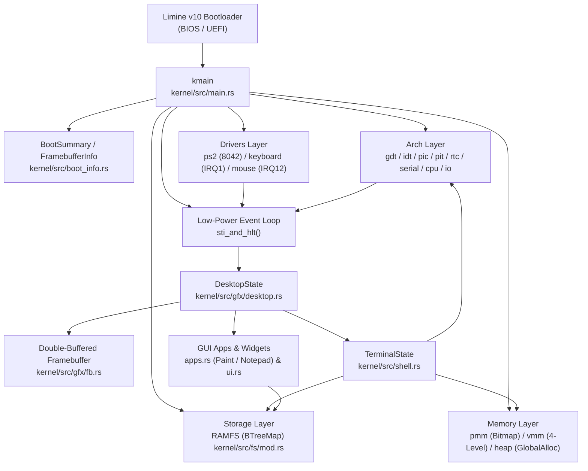
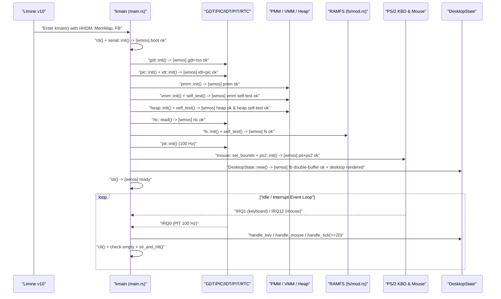

# WMOS (`v2.0.0`) 系统设计与架构文档

> 本文档严格对应仓库当前实现代码，所有地址、常数、数据结构、中断向量、串口标记与构建/验证流程均以实际源码为准。

---

## 1. 项目概览与工程定位

**WMOS**（crate `wmos-kernel` v0.1.0 / 里程碑 `v2.0.0`）是一个基于 **Rust Stable (`#![no_std]`, `#![no_main]`, `edition = "2021"`)** 与 **Limine v10 引导协议** 构建的独立 `x86_64` 微内核桌面操作系统。

- **工程与工具链约束**：
  - 锁定工具链 `channel = "stable"`，目标三元组 `x86_64-unknown-none`（见 [rust-toolchain.toml](../rust-toolchain.toml)）。
  - 编译参数通过 [kernel/.cargo/config.toml](../kernel/.cargo/config.toml) 指定 `"-C", "relocation-model=static", "-C", "code-model=kernel"`；必须在 `kernel/` 目录内执行 `cargo build` 以确保 Cargo 加载该配置。
  - `panic = "abort"`，Release 配置 `opt-level = 2`、`lto = false`（见 [kernel/Cargo.toml](../kernel/Cargo.toml)）。
  - **纯整数无浮点**：内核及图形子系统严禁使用 `f32` / `f64`，渐变插值、进度条比例、Bresenham 光栅化与坐标布局全部采用整数运算（含 `u128` 乘法避免溢出）。
  - **动态堆分配 (`extern crate alloc`)**：通过 [kernel/src/mem/heap.rs](../kernel/src/mem/heap.rs) 提供 IRQ 安全合并式自由链表全局分配器，支撑 `Box`、`Vec`、`String`、`BTreeMap`、RAM 双缓冲帧缓存与 RAMFS。
  - **禁用 nightly 特性**：中断入口采用 `core::arch::global_asm!` 手写保存/恢复 15 个通用寄存器，不使用 `extern "x86-interrupt"` 或 `#[alloc_error_handler]`。
- **研发与验证模式**：
  - 本地负责内核与脚本编写及 `cargo build --release` 静态编译与 ELF64 校验；
  - 完整系统镜像打包（ISO/IMG/QCOW2/VMDK/VHD）与虚拟化启动交互验证由 **GitHub Actions**（`ubuntu-latest`）中的 QEMU Legacy BIOS 与 UEFI (OVMF) 无头自动化流水线完成。

---

## 2. 系统总体分层架构

### 仓库目录与模块职责对照表

| 路径 | 职责说明 |
| :--- | :--- |
| [AGENTS.md](../AGENTS.md) | 仓库强制工程规范与代码-文档同步规则 |
| [README.md](../README.md) | 项目总览、产物下载及 QEMU/VirtualBox/VMware 运行指南 |
| [rust-toolchain.toml](../rust-toolchain.toml) | 锁定 Rust `stable` 工具链与 `x86_64-unknown-none` 目标 |
| [.gitignore](../.gitignore) | 忽略 `/kernel/target/`、`/dist/`、`/limine/`、`/iso_root/` 及镜像产物 |
| [.gitattributes](../.gitattributes) | 强制 `*.sh` 脚本在 Git 检出/提交时保持 LF (`\n`) |
| [.github/workflows/build.yml](../.github/workflows/build.yml) | GitHub Actions 自动编译、打包、QEMU 双模式验证与产物上传 |
| [boot/limine.conf](../boot/limine.conf) | Limine v10 引导配置（`timeout: 1`，`protocol: limine`，`boot():/boot/wmos-kernel`） |
| [docs/DESIGN.md](DESIGN.md) | 系统架构与核心子系统设计文档（本文档） |
| [docs/CHANGELOG.md](CHANGELOG.md) | 版本里程碑与变更追踪日志 |
| [scripts/build-images.sh](../scripts/build-images.sh) | 构建 `wmos.iso`、`wmos.img`、`wmos.qcow2`、`wmos.vmdk`、`wmos.vhd` 与 `SHA256SUMS.txt` |
| [scripts/verify-qemu.sh](../scripts/verify-qemu.sh) | 无头 QEMU BIOS/UEFI 日志断言、键鼠与终端命令注入及 `boot-preview.png` 导出 |
| [kernel/Cargo.toml](../kernel/Cargo.toml) | `wmos-kernel` crate 元数据与 `limine = "0.5"` 依赖 |
| [kernel/.cargo/config.toml](../kernel/.cargo/config.toml) | 裸机目标与 `relocation-model=static`、`code-model=kernel` 编译参数 |
| [kernel/build.rs](../kernel/build.rs) | 传入 `-T kernel/linker-x86_64.ld` 链接参数并监听脚本变更 |
| [kernel/linker-x86_64.ld](../kernel/linker-x86_64.ld) | 高半核 ELF64 链接脚本（基址 `0xffffffff80000000`） |
| [kernel/src/main.rs](../kernel/src/main.rs) | `extern crate alloc`、`kmain` 初始化序列、`sti_and_hlt` 主循环与 `panic_handler` |
| [kernel/src/boot_info.rs](../kernel/src/boot_info.rs) | `BootSummary` 与 `FramebufferInfo` 引导信息契约 |
| [kernel/src/shell.rs](../kernel/src/shell.rs) | `TerminalState`、64 条命令历史、Tab 自动补全、`ShellAction` 与 17 条内置命令 |
| [kernel/src/fs/mod.rs](../kernel/src/fs/mod.rs) | 基于 `BTreeMap` 的内存文件系统 RAMFS（预置文件、读写追加删除及自检） |
| [kernel/src/arch/mod.rs](../kernel/src/arch/mod.rs) | 架构层导出：`cpu`、`gdt`、`idt`、`io`、`pic`、`pit`、`rtc`、`serial` |
| [kernel/src/arch/io.rs](../kernel/src/arch/io.rs) | `inb`、`outb` 与 `0x80` 端口 `io_wait` |
| [kernel/src/arch/cpu.rs](../kernel/src/arch/cpu.rs) | `cli`、`sti`、`hlt`、`sti_and_hlt`、`halt_loop`、`rdtsc`、`read_cr3`、`invlpg`、`reboot` |
| [kernel/src/arch/serial.rs](../kernel/src/arch/serial.rs) | COM1 (`0x3F8`) 115200 8N1 串口驱动与 `serial_print!` / `serial_println!` |
| [kernel/src/arch/gdt.rs](../kernel/src/arch/gdt.rs) | 64 位 GDT、`Tss` 与 16 KiB `DOUBLE_FAULT_STACK`（IST1） |
| [kernel/src/arch/pic.rs](../kernel/src/arch/pic.rs) | 双 8259 PIC 重映射（`0x20`/`0x28`）、IRQ 掩码配置与 `send_eoi` |
| [kernel/src/arch/pit.rs](../kernel/src/arch/pit.rs) | 8254 PIT 通道 0（100 Hz）全局滴答计数 |
| [kernel/src/arch/rtc.rs](../kernel/src/arch/rtc.rs) | CMOS (`0x70`/`0x71`) 实时时钟 `RtcDateTime` 读取与 BCD/12h 解码 |
| [kernel/src/arch/idt.rs](../kernel/src/arch/idt.rs) | 256 项 IDT、`global_asm!` 中断桩与 `isr_dispatch` 分发器 |
| [kernel/src/mem/mod.rs](../kernel/src/mem/mod.rs) | 内存管理导出：`heap`、`pmm`、`vmm` |
| [kernel/src/mem/pmm.rs](../kernel/src/mem/pmm.rs) | 128 KiB 物理页帧位图分配器（最高 4 GiB）与 `PmmStats` |
| [kernel/src/mem/vmm.rs](../kernel/src/mem/vmm.rs) | 4 级页表映射/解映射/地址翻译与开机读写自检 |
| [kernel/src/mem/heap.rs](../kernel/src/mem/heap.rs) | `HEAP_START` 内核堆映射、`#[global_allocator]` 与自检 |
| [kernel/src/drivers/mod.rs](../kernel/src/drivers/mod.rs) | 设备驱动导出：`ps2`、`keyboard`、`mouse` |
| [kernel/src/drivers/ps2.rs](../kernel/src/drivers/ps2.rs) | 8042 PS/2 双端口控制器与鼠标流模式安全初始化 |
| [kernel/src/drivers/keyboard.rs](../kernel/src/drivers/keyboard.rs) | Set 1 + `0xE0` 键盘扫描码解码与 128 槽无锁 SPSC 队列 |
| [kernel/src/drivers/mouse.rs](../kernel/src/drivers/mouse.rs) | IRQ12 3 字节 PS/2 鼠标包同步解码与原子坐标状态 |
| [kernel/src/gfx/mod.rs](../kernel/src/gfx/mod.rs) | 图形层导出：`apps`、`color`、`desktop`、`fb`、`font`、`ui` 及 `DesktopState` |
| [kernel/src/gfx/color.rs](../kernel/src/gfx/color.rs) | RGBX/BGRX 掩码打包与深靛蓝主题调色板常数 |
| [kernel/src/gfx/fb.rs](../kernel/src/gfx/fb.rs) | 双缓冲 RAM 帧缓存、`present_rect`/`present_all` MMIO 刷新与 Bresenham `draw_line` |
| [kernel/src/gfx/font.rs](../kernel/src/gfx/font.rs) | 95 字符 `0x20..=0x7E` 的 `8x8` 点阵字库 |
| [kernel/src/gfx/ui.rs](../kernel/src/gfx/ui.rs) | `StackBuf<N>`、`Window`、`WindowButton`、`draw_progress_bar` 与 `CursorLayer` |
| [kernel/src/gfx/apps.rs](../kernel/src/gfx/apps.rs) | `PaintApp` 画板应用与 `NotepadApp` 文本编辑器（读写 `notes.txt`） |
| [kernel/src/gfx/desktop.rs](../kernel/src/gfx/desktop.rs) | `DesktopState` 4 窗口管理、Start 菜单、任务栏标签、RTC 托盘与局部刷新 |

---

## 3. 内存空间与链接布局

### 3.1 高半核 ELF64 链接布局（`kernel/linker-x86_64.ld`）

- **目标格式与入口**：`OUTPUT_FORMAT(elf64-x86-64)`、`ENTRY(kmain)`。
- **高半核起始虚拟地址**：`. = 0xffffffff80000000;`（配合 `code-model=kernel` 处于高 2 GiB 地址空间）。
- **程序头 (`PHDRS`)**：定义 3 个 `PT_LOAD` 段：`text`、页对齐后的 `rodata`、页对齐后的 `data`（含 `.bss` 和 `COMMON`）。
- **Limine 请求段保护**：在 `.data` 段中显式保留 `KEEP(*(.requests_start_marker))`、`KEEP(*(.requests))`、`KEEP(*(.requests_end_marker))`。
- **丢弃段**：`/DISCARD/` 丢弃 `.eh_frame*` 与 `.note .note.*`。

### 3.2 Limine 请求与 HHDM 直映

[kernel/src/main.rs](../kernel/src/main.rs) 注册 4 项 Limine 请求（`BASE_REVISION`、`FRAMEBUFFER_REQUEST`、`MEMORY_MAP_REQUEST`、`HHDM_REQUEST`），`BootSummary::from_limine` 将 `USABLE` 计入 `usable_ram_bytes` 与 `total_ram_bytes`，并将 `BOOTLOADER_RECLAIMABLE`、`EXECUTABLE_AND_MODULES`、`ACPI_RECLAIMABLE` 计入 `total_ram_bytes`。HHDM 偏移（QEMU 实测 `0xffff800000000000`）用于 VMM 通过 `phys + hhdm()` 直接访问物理页表页帧。

### 3.3 PMM、VMM 与内核堆虚拟地址布局

| 虚拟/物理地址空间 | 用途与容量参数 | 定义位置 |
| :--- | :--- | :--- |
| `0x0000_0000_0010_0000` (`MIN_USABLE_PHYS`) .. `4 GiB` (`MAX_PHYS`) | PMM 4 KiB 页帧位图管理区（`[u64; 16384]` = 128 KiB，最多 `1_048_576` 帧，1 MiB 以下保留） | [kernel/src/mem/pmm.rs](../kernel/src/mem/pmm.rs) |
| `0xffff_8000_0000_0000` (HHDM 基址) | Limine 物理内存直映区，供 VMM 读写四级页表 | [kernel/src/mem/vmm.rs](../kernel/src/mem/vmm.rs) |
| `0xffff_9000_0000_0000` (`TEST_BASE`, 最多扫描 4096 页) | VMM `self_test()` 动态映射/写入 `0x574D_4F53_CAFE_BABE`/解映射测试虚址段 | [kernel/src/mem/vmm.rs](../kernel/src/mem/vmm.rs) |
| `0xffff_a000_0000_0000` (`HEAP_START`, 2 MiB .. 16 MiB) | 内核堆区（`MIN_PAGES = 512` .. `MAX_PAGES = 4096`，映射 `PRESENT \| WRITABLE`） | [kernel/src/mem/heap.rs](../kernel/src/mem/heap.rs) |
| `0xffff_ffff_8000_0000` | 内核 ELF64 高半核代码/只读数据/数据/BSS 映射基址 | [kernel/linker-x86_64.ld](../kernel/linker-x86_64.ld) |

---

## 4. 启动时序与串口状态契约

### 4.1 从引导移交到事件循环

### 4.2 COM1 串口驱动与状态标记契约

COM1（端口 `0x3F8`，[kernel/src/arch/serial.rs](../kernel/src/arch/serial.rs)）初始化为 `115200` 波特率（除数 `0x0001`）、`8N1`（`0x03`）、启用 14 字节 FIFO（`0xC7`），执行环回测试（`0x1E` -> `0xAE`）后恢复 `MCR = 0x0F`；发送轮询 LSR `0x20` 位并将 `'\n'` 转为 `"\r\n"`。

| 串口标记 | 输出位置 | 含义与验证要求 |
| :--- | :--- | :--- |
| `[wmos] boot ok` | `main.rs` | COM1 初始化完成，内核接管控制权（BIOS/UEFI 必检） |
| `[wmos] gdt+tss ok` | `main.rs` | 64 位 GDT、TSS 与 IST1 双重错误栈加载完成（BIOS/UEFI 必检） |
| `[wmos] idt+pic ok` | `main.rs` | 双 8259 PIC 重映射与 256 项 IDT 加载完成（BIOS/UEFI 必检） |
| `[wmos] pmm ok free=<n> total=<n> frames` | `main.rs` | PMM 位图初始化完成（BIOS/UEFI 必检前缀 `[wmos] pmm ok`） |
| `[wmos] vmm self-test ok` | `main.rs` | VMM 4 级页表自检通过（BIOS/UEFI 必检） |
| `[wmos] heap ok size=<kib> KiB` | `main.rs` | 内核堆页映射与 `FreeNode` 初始化完成（BIOS/UEFI 必检前缀 `[wmos] heap ok`） |
| `[wmos] heap self-test ok` | `main.rs` | `Box`/`Vec`/`String` 分配与合并释放自检通过（BIOS/UEFI 必检） |
| `[wmos] rtc ok YYYY-MM-DD HH:MM:SS` | `main.rs` | CMOS RTC 首次一致读取成功（BIOS/UEFI 必检前缀 `[wmos] rtc ok`） |
| `[wmos] fs ok files=<n> bytes=<b>` | `main.rs` | RAMFS 预置文件加载及读写删自检通过（BIOS/UEFI 必检前缀 `[wmos] fs ok`） |
| `[wmos] pit+ps2 ok` | `main.rs` | 100 Hz PIT 与 8042 PS/2 键鼠控制器初始化完成（BIOS/UEFI 必检） |
| `[wmos] limine rev=<r> hhdm=<hex>` | `main.rs` | 打印 Limine 协议版本号与 HHDM 基址 |
| `[wmos] memmap entries=<n> usable=<m> MiB total=<m> MiB` | `main.rs` | 打印物理内存表项数及可用/总内存 MiB |
| `[wmos] fb=<w>x<h> bpp=<b> pitch=
` | `main.rs` | 打印帧缓冲分辨率、位深与行距（BIOS/UEFI 必检前缀 `[wmos] fb=`） |
| `[wmos] fb double-buffer ok (<w>x<h>, <kib> KiB)` | `desktop.rs` | RAM 双缓冲分配成功（BIOS/UEFI 必检前缀 `[wmos] fb double-buffer ok`） |
| `[wmos] desktop rendered` | `main.rs` | 初始桌面、窗口、任务栏与光标渲染并刷新完成（BIOS/UEFI 必检） |
| `[wmos] ready` | `main.rs` | 已执行 `sti()` 开启中断并进入事件循环（BIOS/UEFI 必检） |
| `[wmos] mouse active (<x>, <y>)` | `desktop.rs` | 首次收到鼠标有效数据包（UEFI 交互必检前缀 `[wmos] mouse active`） |
| `[wmos] cmd: <cmd>` | `shell.rs` | 终端执行非空命令（UEFI 交互必检 `ls`、`write demo.txt hello`、`cat demo.txt`、`date`、`open paint`） |
| `[wmos] fs cat <name> ok` | `shell.rs` | `cat` 成功读取并输出 RAMFS 文件（UEFI 交互必检 `[wmos] fs cat demo.txt ok`） |
| `[wmos] notepad saved notes.txt (<n> B)` | `apps.rs` | Notepad 点击 `[Save]` 保存 `notes.txt` 到 RAMFS |
| `[wmos] reboot requested` | `shell.rs` / `desktop.rs` | 通过终端 `reboot` 或 Start 菜单触发重启 |
| `[wmos] EXCEPTION vec=<v> err=<e> rip=<r> rsp=<s>` | `idt.rs` | 捕获 CPU 异常 `0..=31` 并停机（BIOS/UEFI 严禁出现） |
| `[wmos] PANIC: <info>` | `main.rs` | 内核发生 Rust Panic 并停机（BIOS/UEFI 严禁出现） |

---

## 5. 核心子系统详细设计

### 5.1 架构层（`kernel/src/arch/`）

- **GDT 与 TSS（[gdt.rs](../kernel/src/arch/gdt.rs)）**：
  - 5 项 `[u64; 5]` GDT：`0x00` Null、`0x08` 64 位内核代码段 (`0x00AF_9A00_0000_FFFF`)、`0x10` 内核数据段 (`0x00CF_9200_0000_FFFF`)、`0x18..0x20` 16 字节 TSS 描述符（`0x89`）。
  - `Tss.ist[0]` 指向 `16 KiB`（`DOUBLE_FAULT_STACK_SIZE = 16 * 1024`）16 字节对齐栈顶；`lgdt` 后通过 `retfq` 重载 `CS`，重载 `DS/ES/FS/GS/SS` 为 `0x10`，`ltr ax` 加载 `0x18`。
- **IDT 与汇编中断桩（[idt.rs](../kernel/src/arch/idt.rs)）**：
  - 256 项 `IdtTable`（`GATE_INTERRUPT = 0x8E`、`KERNEL_CS = 0x08`），向量 `8`（`#DF`）设置 `ist = 1`。
  - `global_asm!` 覆盖向量 `0..=47` 与 `isr_stub_unknown`（`255`）；硬件压入错误码的异常 `8, 10, 11, 12, 13, 14, 17, 21, 29, 30` 使用 `ISR_ERR`，其余压入 `0`；`isr_common` 压入 15 个通用寄存器（合计 22 个 qword 保持 16 字节对齐）并调用 `isr_dispatch(&InterruptFrame)`：
    - `32` -> `pit::on_irq(); pic::send_eoi(0);`
    - `33` -> `keyboard::on_irq(); pic::send_eoi(1);`
    - `44` -> `mouse::on_irq(); pic::send_eoi(12);`
    - 其余 `32..=47` -> `pic::send_eoi((vec - 32) as u8)`
    - `0..=31` -> 打印 `[wmos] EXCEPTION vec=<v> err=<e> rip=<r> rsp=<s>` 后 `cpu::halt_loop()`。
- **8259 PIC 与 PIT（[pic.rs](../kernel/src/arch/pic.rs), [pit.rs](../kernel/src/arch/pit.rs)）**：
  - 主/从 PIC 重映射至 `0x20` / `0x28`，主片 IMR `0xF8`（开启 IRQ0/IRQ1/IRQ2）、从片 IMR `0xEF`（开启 IRQ12）；`send_eoi(irq)` 当 `irq >= 8` 时向 `0xA0` 与 `0x20` 发送 `0x20`。
  - PIT 通道 0（`0x40`）方波模式 `0x36`、`HZ = 100`（分频系数 `1_193_182 / 100 = 11931`）。
- **CMOS RTC（[rtc.rs](../kernel/src/arch/rtc.rs)）**：
  - 通过 `CMOS_ADDR (0x70)` 与 `CMOS_DATA (0x71)` 读取（写入 `0x80 | reg` 并在结束时写入 `0x0D`）。
  - 循环等待状态寄存器 `0x0A` bit 7（`UIP`）清零后，连续两次读取 `[0x00, 0x02, 0x04, 0x07, 0x08, 0x09, 0x32, 0x0B]` 直至一致（最多 16 轮）。
  - 依据 `reg_b`（`0x0B`）bit 2 判断 BCD 解码、bit 1 判断 12/24 小时制转换；若 `century` 为 `0` 或 `> 99` 则回退 `20`，计算 `year = century * 100 + yr2`。
- **原子休眠与重启（[cpu.rs](../kernel/src/arch/cpu.rs)）**：
  - `sti_and_hlt()` 在同一条 `asm!("sti", "hlt")` 中执行，避免丢失唤醒中断；`reboot()` 优先向 `0x64` 发送 `0xFE` 复位，超时后加载空 `NullIdtr` 执行 `int3` 三重错误重启。

### 5.2 内存管理与内核堆（`kernel/src/mem/`）

- **PMM（[pmm.rs](../kernel/src/mem/pmm.rs)）**：`IrqGuard`（`pushfq` + `cli` + `AtomicBool` 自旋锁）保护 `[u64; 16384]` 位图，循环首次适配 + `trailing_zeros()` 分配 4 KiB 帧。
- **VMM（[vmm.rs](../kernel/src/mem/vmm.rs)）**：按需分配清零四级页表帧，支持 `map_page`、`unmap_page`、`translate`（兼容 1 GiB / 2 MiB 大页读取）与 `self_test()`。
- **Kernel Heap（[heap.rs](../kernel/src/mem/heap.rs)）**：
  - `init()` 根据当前空闲页框数计算目标页数 `cap_pages = (free_frames / 2).max(MIN_PAGES).min(MAX_PAGES)`（即 `2 MiB .. 16 MiB`），逐页调用 `pmm::alloc_frame()` 与 `vmm::map_page(HEAP_START + i * 4096, phys, PRESENT | WRITABLE)`。
  - `KernelAllocator`（`#[global_allocator]`）使用 `IrqGuard` 保护地址有序单向自由链表 `FreeNode`，每次分配在 `user_addr - size_of::<AllocHeader>()` 处记录原始块的 `{ start, size }`，保证任意 `Layout` 对齐（`>= 8`、`MIN_ALIGN = 16`、`MIN_BLOCK_SIZE = 32`）在 `dealloc` 时均可无损归还并与前后相邻空闲块合并（coalescing）。

### 5.3 内存文件系统 RAMFS（[kernel/src/fs/mod.rs](../kernel/src/fs/mod.rs)）

- 使用 `IrqGuard` 保护 `Option<BTreeMap<String, Vec<u8>>>`，保证全局按文件名字典序排列。
- `normalize_name` 去除首尾空白及前导 `/`，拒绝空名、`..` 路径穿越或 `\0` 字符。
- `init()` 预置 `readme.txt`、`motd.txt`、`notes.txt`；提供 `list`、`read`、`read_to_string`、`write`、`append`、`touch`、`remove`、`stats` 与 `self_test()`（写入/校验/删除 `.fs_test`）。

### 5.4 驱动层（`kernel/src/drivers/`）

- **8042 PS/2 控制器初始化顺序（[ps2.rs](../kernel/src/drivers/ps2.rs)）**：
  1. `flush()` -> `0xAD` / `0xA7` 禁用双端口 -> `flush()`；
  2. 读配置字节 `0x20` 后写入 `init_cfg = (base_cfg | 0x40) & !0x33`（启用 Set 1 转换 bit 6、开启时钟清除 bits 4..5，并**保持 IRQ1/IRQ12 bits 0..1 关闭**）；
  3. 发送 `0xAE` / `0xA8` 使能双端口；
  4. 通过 `0xD4` 发送鼠标 `0xF6` 与 `0xF4` 启用流式上报并 `flush()` 掉 `0xFA` ACK；
  5. 最后写入 `final_cfg = init_cfg | 0x03` 开启 IRQ1/IRQ12 并再次 `flush()`。
  - 这样可避免 `0xFA` ACK 在 `cli()` 期间向 8259 PIC 锁存虚假 `IRQ12` 边沿而破坏 `sti()` 后的鼠标数据包对齐。
- **键盘（[keyboard.rs](../kernel/src/drivers/keyboard.rs)）**：`on_irq()` 校验 `(status & 0x01) != 0 && (status & 0x20) == 0`，支持 `0xE0` 方向键、Shift/CapsLock、特殊控制键与 89 项扫描码表，写入 128 槽无锁 SPSC `KEY_QUEUE`。
- **鼠标（[mouse.rs](../kernel/src/drivers/mouse.rs)）**：`on_irq()` 校验 `(inb(0x64) & 0x21) == 0x21`（`OBF` + `AUX_OBF`），`cycle == 0` 强制 `(byte & 0xC8) == 0x08`，完成 3 字节 9 位有符号增量解码与边界钳位，原子写入 `PACKED_STATE: AtomicU64`。

### 5.5 双缓冲图形桌面、内置应用与交互终端（`kernel/src/gfx/` & `kernel/src/shell.rs`）

- **双缓冲帧缓存（[fb.rs](../kernel/src/gfx/fb.rs)）**：
  - 分辨率总像素不超过 `MAX_BACKBUFFER_PIXELS = 3_000_000` 且位深为 `32`/`24` 时，在内核堆分配 `Vec<u32>` 后备缓冲（1280×800 对应 `4000 KiB`），所有绘图均写入高速 RAM，再通过 `present_rect` / `present_all` 按行批量刷入 MMIO VRAM（`32bpp` 优先 4 字节对齐 `write_volatile::<u32>`）。
  - 提供整数 Bresenham 线段画笔 `draw_line`。
- **窗口控制、防残影光标与内置应用（[ui.rs](../kernel/src/gfx/ui.rs), [apps.rs](../kernel/src/gfx/apps.rs)）**：
  - `Window` 标题栏三圆点对应 `WindowButton::Close`（红）、`Minimize`（黄）、`Reset`（绿，恢复初始位置大小并置顶）。
  - `CursorLayer` 每次交互/刷新前先 `restore` 保存的 `12x16` 背景，再重绘并 `save_and_draw`。
  - **`PaintApp` (`WMOS Paint`)**：`360x220` 画布、6 种色板、`[S]`/`[L]` 笔刷半径切换（`1`/`3`）、`Clear` 按钮，左键连续 Bresenham 绘制、右键橡皮擦除。
  - **`NotepadApp` (`WMOS Notepad`)**：自动读取 RAMFS `notes.txt`，支持字符输入/换行/退格/Tab 缩进与自动折行闪烁光标，顶部工具栏提供 `Load` / `Save` / `Clear` 按钮及状态提示（`Loaded` / `Modified` / `Saved` / `Cleared`）。
- **桌面合成与任务栏（[desktop.rs](../kernel/src/gfx/desktop.rs)）**：
  - 管理 4 个窗口（`System Info`、`WMOS Terminal`、`WMOS Paint`、`WMOS Notepad`），初始仅打开前两者且终端置顶（`z_order = [2, 3, 0, 1]`）。
  - 左下角 `WMOS` 按钮可切换 5 项 Start 菜单（4 个应用及 `Reboot System`）；任务栏显示所有非 `Closed` 窗口标签（`Info`、`Term`、`Paint`、`Note`），点击可恢复/置顶或最小化当前活跃窗口；右下角托盘实时显示 CMOS RTC 日期时间与鼠标坐标。
- **交互终端（[shell.rs](../kernel/src/shell.rs)）**：
  - `MAX_LINES = 64`、`MAX_HISTORY = 64`、`MAX_INPUT_LEN = 96`。
  - 支持 `Up`/`Down` 命令历史回溯（并保留当前 `draft`）、`Left`/`Right` 行内光标移动、`Tab` 智能补全（命令名、`open <app>` 应用名及 RAMFS 文件名）。
  - 支持 17 条命令：`help`、`info`、`mem`、`date`、`uptime`、`ls`、`cat <f>`、`write <f> <txt>`、`append <f> <txt>`、`touch <f>`、`rm <f>`、`stat <f>`、`open <info|term|paint|notepad>`、`echo`、`clear`、`about`、`reboot`。

---

## 6. 构建、多格式镜像与云端 QEMU 校验体系

- **CI 工作流（[.github/workflows/build.yml](../.github/workflows/build.yml)）**：在 `ubuntu-latest` 上安装 `xorriso`、`mtools`、`gdisk`、`qemu-utils`、`qemu-system-x86`、`ovmf`、`build-essential`、`python3` 与 Rust `stable` (`x86_64-unknown-none`)，在 `working-directory: kernel` 下执行 `cargo build --release`，随后运行 `./scripts/build-images.sh` 与 `./scripts/verify-qemu.sh`，并上传 `wmos-images` 与 `wmos-ci-logs-and-preview`。
- **镜像打包（[scripts/build-images.sh](../scripts/build-images.sh)）**：
  - 获取并构建 `limine` `v10.x-binary`；
  - 生成 Hybrid BIOS+UEFI `dist/wmos.iso` 并安装 Limine BIOS 引导；
  - 生成 64 MiB GPT 磁盘 `dist/wmos.img`：分区 1（`2048:4095`，`ef02` BIOS Boot）供 `./limine/limine bios-install dist/wmos.img 1`；分区 2（`4096:+60M`，`ef00` ESP）以 `mformat -i dist/wmos.img@@2M -T 122880 -F ::` 格式化并写入内核与引导文件；
  - 转换输出 `wmos.qcow2`、`wmos.vmdk`、`wmos.vhd` 及 `SHA256SUMS.txt`。
- **QEMU 自动化验证（[scripts/verify-qemu.sh](../scripts/verify-qemu.sh)）**：
  - 校验 Legacy BIOS（`timeout 12s`）与 UEFI OVMF 两份串口日志均包含全部 14 项启动标记且不含 `[wmos] PANIC` / `[wmos] EXCEPTION`；
  - 在 UEFI 模式下通过 `/tmp/wmos-mon.sock` 注入 `mouse_move 40 25` 与 5 条终端命令（`ls`、`write demo.txt hello`、`cat demo.txt`、`date`、`open paint`），断言 `[wmos] mouse active` 与全部命令/RAMFS 标记，最终执行 `screendump` 并由纯 Python 标准库转为 `dist/boot-preview.png`。

---

## 7. 已知边界与后续演进路线

### 当前已知边界（`v2.0.0`）

- **单核运行**：仅在 BSP（引导处理器）运行，尚未唤醒 AP 多核。
- **传统外设与易失存储**：使用 8259 PIC 与 PIT 100 Hz，尚未迁移 APIC / HPET；RAMFS 数据全部驻留内存，重启后不持久化到磁盘。
- **静态页帧上限与特权级**：PMM 位图固定管理最高 `4 GiB` 物理地址；全部代码及窗口应用均运行在 Ring 0 内核态，尚未创建独立用户态进程空间。

### 后续演进路线

- **多核与高级中断**：引入 ACPI 表解析、Local APIC / IOAPIC 与 SMP 多核调度器。
- **持久化存储与设备总线**：新增 PCIe 枚举、VirtIO-Blk / AHCI / NVMe 块设备驱动及磁盘 FAT32 / ext2 持久化挂载。
- **Ring 3 用户态隔离**：补全 GDT 用户段与 `TSS.rsp[0]`，实现独立进程页表、`syscall/sysret` 系统调用与 ELF 用户态程序加载。

---

## 8. 文档同步维护规范

本仓库实行**代码与文档强一致**规范（详见 [AGENTS.md](../AGENTS.md)）：凡修改任何源码、链接脚本、引导配置、打包/校验脚本或 CI 工作流，**必须在同一提交中**同步更新 [docs/DESIGN.md](DESIGN.md)、[docs/CHANGELOG.md](CHANGELOG.md)（以及受影响时的 [README.md](../README.md)）。
