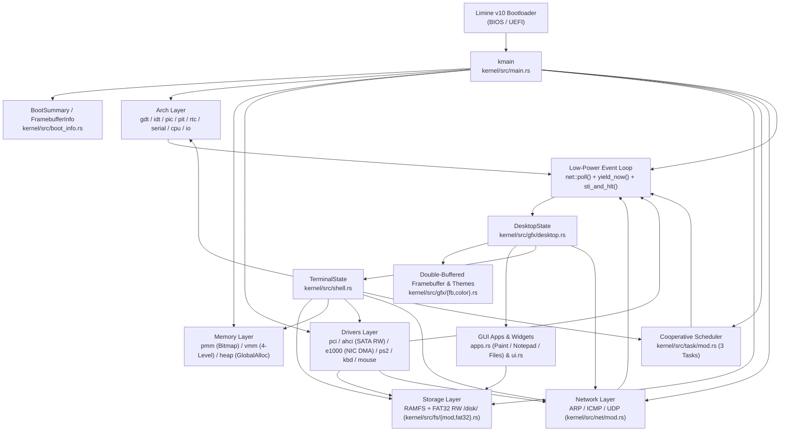
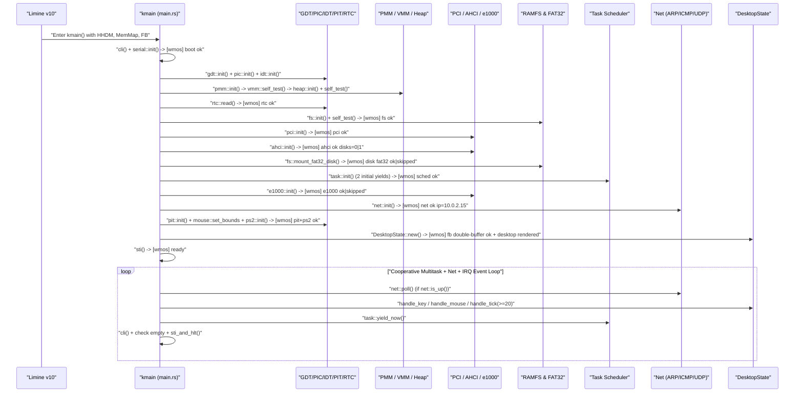

# WMOS (`v4.1.0`) 系统设计与架构文档

> 本文档严格对应仓库当前实现代码，所有地址、常数、数据结构、中断向量、串口标记与构建/验证流程均以实际源码为准。

---

## 1. 项目概览与工程定位

**WMOS**（crate `wmos-kernel` v0.1.0 / 里程碑 `v4.1.0`）是一个基于 **Rust Stable (`#![no_std]`, `#![no_main]`, `edition = "2021"`)** 与 **Limine v10 引导协议** 构建的独立 `x86_64` 微内核桌面操作系统。

- **工程与工具链约束**：
  - 锁定工具链 `channel = "stable"`，目标三元组 `x86_64-unknown-none`（见 [rust-toolchain.toml](../rust-toolchain.toml)）。
  - 编译参数通过 [kernel/.cargo/config.toml](../kernel/.cargo/config.toml) 指定 `"-C", "relocation-model=static", "-C", "code-model=kernel"`；必须在 `kernel/` 目录内执行 `cargo build` 以确保 Cargo 加载该配置。
  - `panic = "abort"`，Release 配置 `opt-level = 2`、`lto = false`（见 [kernel/Cargo.toml](../kernel/Cargo.toml)）。
  - **纯整数无浮点**：内核及图形子系统严禁使用 `f32` / `f64`，渐变插值、进度条比例、Bresenham 光栅化与坐标布局全部采用整数运算（含 `u128` 乘法避免溢出）。
  - **动态堆分配 (`extern crate alloc`)**：通过 [kernel/src/mem/heap.rs](../kernel/src/mem/heap.rs) 提供 IRQ 安全合并式自由链表全局分配器，支撑 `Box`、`Vec`、`String`、`BTreeMap`、RAM 双缓冲帧缓存、FAT32 索引、任务内核栈与 RAMFS。
  - **禁用 nightly 特性**：中断入口（[kernel/src/arch/idt.rs](../kernel/src/arch/idt.rs)）与协作式上下文切换（[kernel/src/task/mod.rs](../kernel/src/task/mod.rs)）均采用 `core::arch::global_asm!` 实现，不使用 `extern "x86-interrupt"` 或 `#[alloc_error_handler]`。
- **研发与验证模式**：
  - 本地负责内核与脚本编写及 `cargo build --release` 静态编译与 ELF64 校验；
  - 完整系统镜像打包（ISO/IMG/QCOW2/VMDK/VHD）与虚拟化启动交互验证由 **GitHub Actions**（`ubuntu-latest`）中的 QEMU Legacy BIOS 与 UEFI (OVMF) 无头自动化流水线完成。

---

## 2. 系统总体分层架构

### 仓库目录与模块职责对照表

| 路径 | 职责说明 |
| :--- | :--- |
| [AGENTS.md](../AGENTS.md) | 仓库强制工程规范与代码-文档同步规则 |
| [README.md](../README.md) | 项目总览、产物下载及 QEMU/VirtualBox/VMware 运行指南 |
| [rust-toolchain.toml](../rust-toolchain.toml) | 锁定 Rust `stable` 工具链与 `x86_64-unknown-none` 目标 |
| [.gitignore](../.gitignore) | 忽略 `/kernel/target/`、`/dist/`、`/limine/`、`/iso_root/` 及镜像产物 |
| [.gitattributes](../.gitattributes) | 强制 `*.sh` 脚本在 Git 检出/提交时保持 LF (`\n`) |
| [.github/workflows/build.yml](../.github/workflows/build.yml) | GitHub Actions 自动编译、打包、QEMU 双模式验证与产物上传 |
| [boot/limine.conf](../boot/limine.conf) | Limine v10 引导配置（`timeout: 1`，`protocol: limine`，`boot():/boot/wmos-kernel`） |
| [docs/DESIGN.md](DESIGN.md) | 系统架构与核心子系统设计文档（本文档） |
| [docs/CHANGELOG.md](CHANGELOG.md) | 版本里程碑与变更追踪日志 |
| [scripts/build-images.sh](../scripts/build-images.sh) | 构建 `wmos.iso`、`wmos.img`、`wmos.qcow2`、`wmos.vmdk`、`wmos.vhd` 与 `SHA256SUMS.txt` |
| [scripts/verify-qemu.sh](../scripts/verify-qemu.sh) | 无头 QEMU BIOS/UEFI（含 SATA 磁盘持久化、冷重启与 e1000 `ping`）断言、命令注入与 `boot-preview.png` 导出 |
| [kernel/Cargo.toml](../kernel/Cargo.toml) | `wmos-kernel` crate 元数据与 `limine = "0.5"` 依赖 |
| [kernel/.cargo/config.toml](../kernel/.cargo/config.toml) | 裸机目标与 `relocation-model=static`、`code-model=kernel` 编译参数 |
| [kernel/build.rs](../kernel/build.rs) | 传入 `-T kernel/linker-x86_64.ld` 链接参数并监听脚本变更 |
| [kernel/linker-x86_64.ld](../kernel/linker-x86_64.ld) | 高半核 ELF64 链接脚本（基址 `0xffffffff80000000`） |
| [kernel/src/main.rs](../kernel/src/main.rs) | `kmain` 初始化序列、`net::poll()` + `task::yield_now()` + `sti_and_hlt()` 主循环与 `panic_handler` |
| [kernel/src/boot_info.rs](../kernel/src/boot_info.rs) | `BootSummary` 与 `FramebufferInfo` 引导信息契约 |
| [kernel/src/shell.rs](../kernel/src/shell.rs) | `TerminalState`、64 条命令历史、Tab 补全、`ShellAction` 与 25 条内置命令（含 `ifconfig`/`ping`/`udp`） |
| [kernel/src/task/mod.rs](../kernel/src/task/mod.rs) | 3 任务协作式调度器、`global_asm!` 上下文切换与 `TaskInfo` |
| [kernel/src/net/mod.rs](../kernel/src/net/mod.rs) | `NetConfig`（`10.0.2.15/24`）、IPv4/ARP/ICMP/UDP 协议栈与 `ping` / `send_udp` |
| [kernel/src/fs/mod.rs](../kernel/src/fs/mod.rs) | 统一文件系统层：可读写 RAMFS 与根目录 `/disk/<8.3>` FAT32 持久化挂载（子目录写保护） |
| [kernel/src/fs/fat32.rs](../kernel/src/fs/fat32.rs) | GPT (`EFI PART`, `ef00`) 与 FAT32 BPB/簇链/LFN+8.3 读写及根目录文件增删驱动 |
| [kernel/src/arch/mod.rs](../kernel/src/arch/mod.rs) | 架构层导出：`cpu`、`gdt`、`idt`、`io`、`pic`、`pit`、`rtc`、`serial` |
| [kernel/src/arch/io.rs](../kernel/src/arch/io.rs) | 端口 I/O：`inb`、`outb`、`inw`、`outw`、`inl`、`outl` 与 `io_wait` |
| [kernel/src/arch/cpu.rs](../kernel/src/arch/cpu.rs) | `cli`、`sti`、`hlt`、`sti_and_hlt`、`halt_loop`、`rdtsc`、`read_cr3`、`invlpg`、`reboot`、`shutdown` |
| [kernel/src/arch/serial.rs](../kernel/src/arch/serial.rs) | COM1 (`0x3F8`) 115200 8N1 串口驱动与 `serial_print!` / `serial_println!` |
| [kernel/src/arch/gdt.rs](../kernel/src/arch/gdt.rs) | 64 位 GDT、`Tss` 与 16 KiB `DOUBLE_FAULT_STACK`（IST1） |
| [kernel/src/arch/pic.rs](../kernel/src/arch/pic.rs) | 双 8259 PIC 重映射（`0x20`/`0x28`）、IRQ 掩码配置与 `send_eoi` |
| [kernel/src/arch/pit.rs](../kernel/src/arch/pit.rs) | 8254 PIT 通道 0（100 Hz）全局滴答计数 |
| [kernel/src/arch/rtc.rs](../kernel/src/arch/rtc.rs) | CMOS (`0x70`/`0x71`) 实时时钟 `RtcDateTime` 读取与 BCD/12h 解码 |
| [kernel/src/arch/idt.rs](../kernel/src/arch/idt.rs) | 256 项 IDT、`global_asm!` 中断桩与 `isr_dispatch` 分发器 |
| [kernel/src/mem/mod.rs](../kernel/src/mem/mod.rs) | 内存管理导出：`heap`、`pmm`、`vmm` |
| [kernel/src/mem/pmm.rs](../kernel/src/mem/pmm.rs) | 128 KiB 物理页帧位图分配器（最高 4 GiB）与 `PmmStats` |
| [kernel/src/mem/vmm.rs](../kernel/src/mem/vmm.rs) | 4 级页表映射/解映射/地址翻译（支持 `WRITE_THROUGH` / `CACHE_DISABLE`）与自检 |
| [kernel/src/mem/heap.rs](../kernel/src/mem/heap.rs) | `HEAP_START` 内核堆映射、`#[global_allocator]` 与自检 |
| [kernel/src/drivers/mod.rs](../kernel/src/drivers/mod.rs) | 设备驱动导出：`ahci`、`e1000`、`keyboard`、`mouse`、`pci`、`ps2` |
| [kernel/src/drivers/pci.rs](../kernel/src/drivers/pci.rs) | PCI 配置空间（`0xCF8`/`0xCFC`）总线 `0..=7` 设备枚举（含 `bar0`/`bar5`）与厂商/类别映射 |
| [kernel/src/drivers/ahci.rs](../kernel/src/drivers/ahci.rs) | AHCI SATA 控制器 DMA 读写驱动（`IDENTIFY 0xEC`、`READ_DMA_EXT 0x25`、`WRITE_DMA_EXT 0x35`、`FLUSH_CACHE_EXT 0xEA`） |
| [kernel/src/drivers/e1000.rs](../kernel/src/drivers/e1000.rs) | Intel e1000/e1000e NIC DMA 驱动（MMIO 128 KiB、16 槽 RX/TX 环与 `NicInfo`） |
| [kernel/src/drivers/ps2.rs](../kernel/src/drivers/ps2.rs) | 8042 PS/2 双端口控制器与鼠标流模式安全初始化 |
| [kernel/src/drivers/keyboard.rs](../kernel/src/drivers/keyboard.rs) | Set 1 + `0xE0` 键盘扫描码解码与 128 槽无锁 SPSC 队列 |
| [kernel/src/drivers/mouse.rs](../kernel/src/drivers/mouse.rs) | IRQ12 3 字节 PS/2 鼠标包同步解码与原子坐标状态 |
| [kernel/src/gfx/mod.rs](../kernel/src/gfx/mod.rs) | 图形层导出：`apps`、`color`、`desktop`、`fb`、`font`、`ui` 及 `DesktopState` |
| [kernel/src/gfx/color.rs](../kernel/src/gfx/color.rs) | RGBX/BGRX 掩码打包、调色板常数与 `Theme::{Dark, Ocean, Amber}` |
| [kernel/src/gfx/fb.rs](../kernel/src/gfx/fb.rs) | 双缓冲 RAM 帧缓存、`present_rect`/`present_all` MMIO 刷新与 Bresenham `draw_line` |
| [kernel/src/gfx/font.rs](../kernel/src/gfx/font.rs) | 95 字符 `0x20..=0x7E` 的 `8x8` 点阵字库 |
| [kernel/src/gfx/ui.rs](../kernel/src/gfx/ui.rs) | `StackBuf<N>`、`Window`、`WindowButton`、`draw_progress_bar` 与 `CursorLayer` |
| [kernel/src/gfx/apps.rs](../kernel/src/gfx/apps.rs) | `PaintApp` 画板、`NotepadApp` 编辑器（支持 `/disk/<8.3>` 保存与子目录只读保护）与 `FilesApp` 文件管理器 |
| [kernel/src/gfx/desktop.rs](../kernel/src/gfx/desktop.rs) | `DesktopState` 5 窗口管理、Start 菜单、主题切换、动态任务栏与实时监控 |

---

## 3. 内存空间与链接布局

### 3.1 高半核 ELF64 链接布局（`kernel/linker-x86_64.ld`）

- **目标格式与入口**：`OUTPUT_FORMAT(elf64-x86-64)`、`ENTRY(kmain)`。
- **高半核起始虚拟地址**：`. = 0xffffffff80000000;`（配合 `code-model=kernel` 处于高 2 GiB 地址空间）。
- **程序头 (`PHDRS`)**：3 个 `PT_LOAD` 段：`text`、页对齐后的 `rodata`、页对齐后的 `data`（含 `.bss` 和 `COMMON`）。
- **Limine 请求段保护**：在 `.data` 段中显式保留 `KEEP(*(.requests_start_marker))`、`KEEP(*(.requests))`、`KEEP(*(.requests_end_marker))`，并丢弃 `.eh_frame*` 与 `.note .note.*`。

### 3.2 Limine 请求、PMM、VMM、Heap 与 MMIO 虚拟地址布局

[kernel/src/main.rs](../kernel/src/main.rs) 注册 4 项 Limine 请求（`BASE_REVISION`、`FRAMEBUFFER_REQUEST`、`MEMORY_MAP_REQUEST`、`HHDM_REQUEST`），`BootSummary::from_limine` 统计 `usable_ram_bytes` 与 `total_ram_bytes`。

| 虚拟/物理地址空间 | 用途与容量参数 | 定义位置 |
| :--- | :--- | :--- |
| `0x0000_0000_0010_0000` (`MIN_USABLE_PHYS`) .. `4 GiB` (`MAX_PHYS`) | PMM 4 KiB 页帧位图管理区（`[u64; 16384]` = 128 KiB，最多 `1_048_576` 帧，1 MiB 以下保留） | [kernel/src/mem/pmm.rs](../kernel/src/mem/pmm.rs) |
| `0xffff_8000_0000_0000` (HHDM 基址) | Limine 物理内存直映区，供 VMM 访问四级页表及 AHCI 访问物理 DMA 帧 | [kernel/src/mem/vmm.rs](../kernel/src/mem/vmm.rs) |
| `0xffff_9000_0000_0000` (`TEST_BASE`, 最多扫描 4096 页) | VMM `self_test()` 动态映射/写入 `0x574D_4F53_CAFE_BABE`/解映射测试虚址段 | [kernel/src/mem/vmm.rs](../kernel/src/mem/vmm.rs) |
| `0xffff_a000_0000_0000` (`HEAP_START`, 2 MiB .. 16 MiB) | 内核堆区（`MIN_PAGES = 512` .. `MAX_PAGES = 4096`，映射 `PRESENT \| WRITABLE`） | [kernel/src/mem/heap.rs](../kernel/src/mem/heap.rs) |
| `0xffff_b000_0000_0000` (`AHCI_MMIO_VIRT`, 2 页 = 8 KiB) | AHCI HBA BAR5 寄存器映射区（`PRESENT \| WRITABLE \| WRITE_THROUGH \| CACHE_DISABLE`） | [kernel/src/drivers/ahci.rs](../kernel/src/drivers/ahci.rs) |
| `0xffff_b001_0000_0000` (`E1000_MMIO_VIRT`, 32 页 = 128 KiB) | Intel e1000 NIC BAR0 寄存器映射区（`PRESENT \| WRITABLE \| WRITE_THROUGH \| CACHE_DISABLE`） | [kernel/src/drivers/e1000.rs](../kernel/src/drivers/e1000.rs) |
| `0xffff_ffff_8000_0000` | 内核 ELF64 高半核代码/只读数据/数据/BSS 映射基址 | [kernel/linker-x86_64.ld](../kernel/linker-x86_64.ld) |

---

## 4. 启动时序与串口状态契约

### 4.1 从引导移交到调度事件循环

### 4.2 COM1 串口驱动与状态标记契约

COM1（端口 `0x3F8`，[kernel/src/arch/serial.rs](../kernel/src/arch/serial.rs)）初始化为 `115200` 波特率、`8N1`、14 字节 FIFO（`0xC7`），执行环回自检后恢复 `MCR = 0x0F`。

| 串口标记 | 输出位置 | 含义与验证要求 |
| :--- | :--- | :--- |
| `[wmos] boot ok` | `main.rs` | COM1 初始化完成（BIOS/UEFI 必检） |
| `[wmos] gdt+tss ok` | `main.rs` | 64 位 GDT、TSS 与 IST1 双重错误栈加载完成（BIOS/UEFI 必检） |
| `[wmos] idt+pic ok` | `main.rs` | 双 8259 PIC 重映射与 256 项 IDT 加载完成（BIOS/UEFI 必检） |
| `[wmos] pmm ok free=<n> total=<n> frames` | `main.rs` | PMM 位图初始化完成（BIOS/UEFI 必检前缀 `[wmos] pmm ok`） |
| `[wmos] vmm self-test ok` | `main.rs` | VMM 4 级页表自检通过（BIOS/UEFI 必检） |
| `[wmos] heap ok size=<kib> KiB` | `main.rs` | 内核堆映射与自由链表初始化完成（BIOS/UEFI 必检前缀 `[wmos] heap ok`） |
| `[wmos] heap self-test ok` | `main.rs` | `Box`/`Vec`/`String` 分配与合并释放自检通过（BIOS/UEFI 必检） |
| `[wmos] rtc ok YYYY-MM-DD HH:MM:SS` | `main.rs` | CMOS RTC 首次一致读取成功（BIOS/UEFI 必检前缀 `[wmos] rtc ok`） |
| `[wmos] fs ok files=<n> bytes=<b>` | `main.rs` | RAMFS 预置文件加载及自检通过（BIOS/UEFI 必检前缀 `[wmos] fs ok`） |
| `[wmos] pci ok devices=<n>` | `main.rs` | PCI 总线 `0..=7` 枚举完成（BIOS/UEFI 必检前缀 `[wmos] pci ok`） |
| `[wmos] ahci ok disks=<0\|1> model=<m> sectors=<s>` | `main.rs` | AHCI 探测与 `IDENTIFY` 完成（BIOS/UEFI 必检前缀 `[wmos] ahci ok`；UEFI 挂载磁盘必检 `[wmos] ahci ok disks=1`） |
| `[wmos] disk fat32 ok files=<n>` / `[wmos] disk fat32 skipped` | `main.rs` | 挂盘时索引 `/disk/` 文件数（UEFI 必检 `[wmos] disk fat32 ok`）；无盘时打印 `skipped` |
| `[wmos] sched ok tasks=<n>` | `main.rs` | 3 任务协作调度器初始化且至少完成 2 次上下文切换（BIOS/UEFI 必检前缀 `[wmos] sched ok`） |
| `[wmos] e1000 ok mac=<mac>` / `[wmos] e1000 skipped` | `main.rs` | 检测到 Intel e1000/e1000e 并完成 MMIO 与收发环初始化（UEFI Boot #1 必检前缀 `[wmos] e1000 ok mac=`） |
| `[wmos] net ok ip=<ip> gw=<gw>` | `main.rs` | IPv4/ARP/ICMP/UDP 协议栈启动（UEFI Boot #1 必检前缀 `[wmos] net ok ip=10.0.2.15`） |
| `[wmos] pit+ps2 ok` | `main.rs` | 100 Hz PIT 与 8042 PS/2 初始化完成（BIOS/UEFI 必检） |
| `[wmos] limine rev=<r> hhdm=<hex>` | `main.rs` | 打印 Limine 协议版本号与 HHDM 基址 |
| `[wmos] memmap entries=<n> usable=<m> MiB total=<m> MiB` | `main.rs` | 打印物理内存表项数及可用/总内存 MiB |
| `[wmos] fb=<w>x<h> bpp=<b> pitch=
` | `main.rs` | 打印帧缓冲分辨率、位深与行距（BIOS/UEFI 必检前缀 `[wmos] fb=`） |
| `[wmos] fb double-buffer ok (<w>x<h>, <kib> KiB)` | `desktop.rs` | RAM 双缓冲分配成功（BIOS/UEFI 必检前缀 `[wmos] fb double-buffer ok`） |
| `[wmos] desktop rendered` | `main.rs` | 初始桌面、窗口、任务栏与光标渲染完成（BIOS/UEFI 必检） |
| `[wmos] ready` | `main.rs` | 已执行 `sti()` 开启中断并进入主循环（BIOS/UEFI 必检） |
| `[wmos] mouse active (<x>, <y>)` | `desktop.rs` | 首次收到鼠标有效数据包（UEFI 交互必检前缀 `[wmos] mouse active`） |
| `[wmos] cmd: <cmd>` | `shell.rs` | 终端执行命令（UEFI Boot #1 必检 `lspci`、`ps`、`disks`、`cat /disk/boot/limine/limine.conf`、`write demo.txt hello`、`write /disk/persist.txt hello-v4`、`ifconfig`、`ping 10.0.2.2`、`open files`；Boot #2 冷重启必检 `cat /disk/persist.txt`） |
| `[wmos] fs cat <name> ok` | `shell.rs` | `cat` 成功读取 RAMFS 或 FAT32 磁盘文件（UEFI Boot #1 必检 `disk/boot/limine/limine.conf` 与 `demo.txt`；Boot #2 冷重启必检 `disk/persist.txt`） |
| `[wmos] fs disk write <norm> ok (<B> B)` | `fs/mod.rs` | `write`/`append`/`touch` 成功写入根目录 `/disk/<8.3>` FAT32 文件并刷盘（UEFI Boot #1 必检前缀 `[wmos] fs disk write disk/persist.txt ok`） |
| `[wmos] fs disk rm <norm> ok` | `fs/mod.rs` | `rm` 或 `FilesApp` 成功删除根目录 `/disk/<8.3>` FAT32 文件并释放簇链 |
| `[wmos] ping <ip> ok rtt=<ms>ms` | `shell.rs` | `ping` 收到首个匹配 ICMP Echo Reply 并输出往返时间（UEFI Boot #1 必检前缀 `[wmos] ping 10.0.2.2 ok`） |
| `[wmos] udp sent <ip>:<port>` | `shell.rs` | `udp` 命令成功通过 `net::send_udp` 发送 UDP/IPv4 数据报 |
| `[wmos] notepad saved <name> (<n> B)` | `apps.rs` | `Notepad` 保存文件到 RAMFS 或根目录 `/disk/<8.3>` FAT32 磁盘 |
| `[wmos] reboot requested` / `[wmos] poweroff requested` | `shell.rs` / `desktop.rs` | 触发重启或 ACPI 关机 |
| `[wmos] EXCEPTION vec=<v> err=<e> rip=<r> rsp=<s>` | `idt.rs` | 捕获 CPU 异常 `0..=31` 并停机（BIOS/UEFI 严禁出现） |
| `[wmos] PANIC: <info>` | `main.rs` | 内核发生 Rust Panic 并停机（BIOS/UEFI 严禁出现） |

---

## 5. 核心子系统详细设计

### 5.1 架构层（`kernel/src/arch/`）

- **16/32 位端口 I/O 与关机（[io.rs](../kernel/src/arch/io.rs), [cpu.rs](../kernel/src/arch/cpu.rs)）**：新增 `inw`/`outw`/`inl`/`outl` 供 PCI 与 ACPI 端口访问；`cpu::shutdown()` 关中断后依次向 QEMU/Bochs/VirtualBox ACPI 关机端口写入 `outw(0x604, 0x2000)`、`outw(0xB004, 0x2000)`、`outw(0x4004, 0x3400)`，未立即断电则进入 `halt_loop()`。`sti_and_hlt()` 原子开中断休眠。
- **GDT/TSS、IDT、8259 PIC、PIT 与 CMOS RTC**：64 位 GDT + `16 KiB` `DOUBLE_FAULT_STACK`（IST1）、256 项 IDT + `global_asm!` 15 寄存器保存桩、8259 PIC 重映射 `0x20`/`0x28`（掩码 `0xF8`/`0xEF`）、100 Hz PIT（`11931`）、CMOS `0x70`/`0x71` 双读一致性 `RtcDateTime`。

### 5.2 内存管理与内核堆（`kernel/src/mem/`）

- **PMM（[pmm.rs](../kernel/src/mem/pmm.rs)）**：`IrqGuard` + `[u64; 16384]` 4 KiB 位图（`[0x10_0000, 4 GiB)`）。
- **VMM（[vmm.rs](../kernel/src/mem/vmm.rs)）**：新增 `WRITE_THROUGH = 1 << 3` 与 `CACHE_DISABLE = 1 << 4` 页表标志，在 `map_page` 中允许 `(PRESENT | WRITABLE | WRITE_THROUGH | CACHE_DISABLE | NO_EXECUTE)` 组合以支撑设备 MMIO 非缓存映射，并导出 `hhdm_offset()` 供 DMA 物理帧访问。
- **Heap（[heap.rs](../kernel/src/mem/heap.rs)）**：映射 `2 MiB .. 16 MiB` 于 `HEAP_START = 0xFFFF_A000_0000_0000`，`AllocHeader` 支持任意对齐无泄漏合并释放。

### 5.3 PCI 枚举、AHCI SATA DMA 与 Intel e1000 网卡驱动（`kernel/src/drivers/`）

- **PCI 配置空间枚举（[pci.rs](../kernel/src/drivers/pci.rs)）**：
  - 使用标准 Type 1 配置机制端口 `PCI_CONFIG_ADDR (0xCF8)` 与 `PCI_CONFIG_DATA (0xCFC)`（使能位 `0x8000_0000`）。
  - `init()` 扫描总线 `0..=7`、设备 `0..32`；读取 `vendor_id` (`0x00`)，非 `0xFFFF` 时读取 `class_code`/`subclass`/`prog_if` (`0x08`)、`header_type` (`0x0C`)、`bar0` (`0x10`)、`bar5` (`0x24`) 及 `irq_line` (`0x3C`)；若 `header_type & 0x80 != 0` 则继续扫描多功能 `1..8`。
  - 提供 `class_name` 与 `vendor_name`（涵盖 `0x8086` Intel、`0x1234` QEMU、`0x1AF4` RedHat/VirtIO、`0x1B36` QEMU/RedHat、`0x15AD` VMware、`0x80EE` VirtualBox 等）。
- **AHCI SATA 控制器与 DMA 读写（[ahci.rs](../kernel/src/drivers/ahci.rs)）**：
  - 检索 PCI 类码 `class_code == 0x01 && subclass == 0x06 && prog_if == 0x01`（SATA AHCI）设备，读取 `bar5 & !0xF`，写 PCI Command (`0x04`) 置位 `0x06`（Memory Space + Bus Master DMA）。
  - 将 `bar5_phys` 起 `2` 页（`8 KiB`）以 `PRESENT | WRITABLE | WRITE_THROUGH | CACHE_DISABLE` 映射至 `AHCI_MMIO_VIRT (0xFFFF_B000_0000_0000)`。
  - 置位 `HBA_GHC` (`0x04`) bit 31（AHCI Enable），遍历 `HBA_PI` (`0x0C`) 32 个端口位，定位首个满足 `det == 3`、`ipm == 1` 且 `PX_SIG == 0x0000_0101` (`SATA_SIG_ATA`) 的活动 SATA 盘。
  - 执行 `stop_port`（清 `ST`/`FRE` 并等待 `CR`/`FR` 停止），分配 2 个 4 KiB PMM 物理帧：
    - `ctrl_phys`：Offset `0x000` 放 `HbaCmdHeader` (`CLB`)，Offset `0x400` 放接收 FIS (`FB`)，Offset `0x800` 放命令表 + Host-to-Device FIS (`0x27`) + PRDT (`CTBA`)；
    - `dma_phys`：4 KiB 物理 DMA 中转缓冲区（通过 `dma_phys + hhdm_offset()` 读写）。
  - 执行 `start_port` 后下发 `ATA_CMD_IDENTIFY (0xEC)` 解析 LBA48/LBA28 总扇区数与字节交换后的 40 字节型号字符串 `DiskInfo`。
  - `issue_dma_cmd(port_base, ctrl_phys, dma_phys, ata_cmd, lba, sectors, is_write)`（内部 `is_flush = (ata_cmd == ATA_CMD_FLUSH_CACHE_EXT)`）按传输方向设置命令头标志：写数据（`is_write && !is_flush`）时 `flags = 5 | (1 << 6)`（H2D Write），其余为 `flags = 5`；刷盘命令（`is_flush`）设置 `prdtl = 0`。
  - `read_sectors(lba, count, buf)` 以每次最多 `8` 扇区（`4 KiB`）分片下发 `ATA_CMD_READ_DMA_EXT (0x25)`，完成后从 HHDM 拷贝至目标切片（全过程由 `IrqGuard` 保护）。
  - `write_sectors(lba, count, buf)` 以每次最多 `8` 扇区（`4 KiB`）分片将 `buf` 拷贝至 `(state.dma_phys + hhdm)` 并下发 `ATA_CMD_WRITE_DMA_EXT (0x35)`；全部扇区写入完成后追加下发 `ATA_CMD_FLUSH_CACHE_EXT (0xEA)` 强制磁盘控制器将缓存刷入介质。
- **Intel e1000/e1000e NIC DMA 驱动（[e1000.rs](../kernel/src/drivers/e1000.rs)）**：
  - 检索 PCI 厂商与设备号 `vendor_id == 0x8086 && matches!(device_id, 0x100E | 0x10D3 | 0x100F | 0x1004)`，读取 `bar0 & !0xF` 并写 PCI `0x04` 置位 `0x06`（Memory Space + Bus Master DMA）。
  - 将 `bar0 & !0xFFF` 起 `E1000_MMIO_PAGES = 32` 页（`128 KiB`）以非缓存属性映射至 `E1000_MMIO_VIRT (0xFFFF_B001_0000_0000)`。
  - 向 `REG_IMC (0x00D8)` 写 `0xFFFF_FFFF` 屏蔽中断，置位 `REG_CTRL (0x0000)` `SLU`（bit 6）并清零 `REG_MTA_BASE (0x5200)` 多播过滤表；优先从 `REG_RAL0`/`REG_RAH0` 读取 MAC 地址（全 `0x00` 或全 `0xFF` 时回退读取 `REG_EERD (0x0014)` EEPROM 0..3 字）。
  - 通过 `pmm::alloc_frame()` 与 `vmm::hhdm_offset()` 分配 18 个物理页帧：`1` 帧 16 项 `RxDesc` 环（`256 B`）、`1` 帧 16 项 `TxDesc` 环（初始 `status = 1`）、`8` 帧 RX 缓冲与 `8` 帧 TX 缓冲（每帧容纳 `2 x 2048 B` 槽位，共 `RING_LEN = 16`）。
  - 配置 `RCTL = (1 << 1) | (1 << 15) | (1 << 26)`（`EN | BAM | SECRC`，2048 B 缓冲）、`TCTL = (1 << 1) | (1 << 3) | (0x10 << 4) | (0x40 << 12)` 与 `TIPG = 10 | (8 << 10) | (6 << 20)`；导出 `init()`、`info()`、`send_frame(frame)`（支持 `14..=1514 B`，置位 `EOP | IFCS | RS`）、`poll_recv(buf)` 与原子收发包计数 `stats()`。
- **PS/2 键鼠驱动（[ps2.rs](../kernel/src/drivers/ps2.rs), [keyboard.rs](../kernel/src/drivers/keyboard.rs), [mouse.rs](../kernel/src/drivers/mouse.rs)）**：保持 `ps2::init()` 先屏蔽 IRQ1/IRQ12 发 `0xF6`/`0xF4` 与 `flush()` 再开启 `0x03`，`keyboard` 校验 `(status & 0x21) == 0x01`，`mouse` 校验 `(status & 0x21) == 0x21` 且 `cycle == 0` 校验 `(byte & 0xC8) == 0x08`。

### 5.4 统一文件系统与可读写 FAT32 `/disk/`（`kernel/src/fs/`）

- **GPT 与 FAT32 读写驱动（[fat32.rs](../kernel/src/fs/fat32.rs)）**：
  - 从 `LBA 1` 查找 GPT `"EFI PART"` 签名并匹配 EFI System Partition GUID `28 73 2A C1 1F F8 D2 11 BA 4B 00 A0 C9 3E C9 3B`（回退检查 `LBA 0` FAT32 BPB）。
  - 解析 BPB（要求 `512 B/sector`、`sectors_per_cluster > 0`、`num_fats > 0`、`sectors_per_fat > 0`、`root_cluster >= 2`），记录 `Fat32Volume` 中的 `fat_start_lba`、`data_start_lba`、`num_fats`、`sectors_per_fat`、`root_cluster` 与 `total_clusters`（取 BPB 数据区可容纳簇数与 FAT 表总表项容量之最小值）。
  - `walk_dir` 递归遍历目录（最大深度 `MAX_DIR_DEPTH = 4`、上限 `MAX_FAT_FILES = 256`、`MAX_CLUSTER_HOPS = 8192`、`MAX_READ_BYTES = 4 MiB`），同时支持 `0x0F` LFN UTF-16LE 长文件名与 8.3 短文件名解码，索引路径统一冠以 `disk/` 前缀并排序；读取时若精确大小写未命中则提供 `eq_ignore_ascii_case` 大小写不敏感匹配兜底。
  - **根目录 8.3 写入与删除**：
    - `encode_short_name(name)` 校验 ASCII 字符集（字母/数字/`_`/`-`）、8.3 长度限制与单段大小写一致性并生成 `nt_flags`；
    - `set_fat_entry` 保留高 4 位并将簇链值同步更新至全部 `num_fats` 份 FAT 表；
    - `alloc_chain` 扫描空闲簇（表项值为 `0`）并依次写入链接及末尾 `FAT_EOC (0x0FFF_FFFF)`（写入失败时回滚已分配簇）；`free_chain` 遍历旧簇链逐一清零；
    - `write_root_file(vol, name, data)` 通过 `scan_root_dir` 查找既有条目或首个 `0x00`/`0xE5` 空目录槽（若根目录当前簇已满则分配并清零新簇链至目录末尾），写入新数据簇链后更新 32 字节短目录项（属性 `0x20`、`nt_flags`、首簇高低 16 位及文件长度），随后释放旧簇链并执行 `refresh_index`；
    - `delete_root_file(vol, name)` 校验目标非目录后将 32 字节目录项首字节写入 `0xE5` 释放、调用 `free_chain` 回收簇链并刷新索引。
- **RAMFS + `/disk/` 透明整合与子目录保护（[mod.rs](../kernel/src/fs/mod.rs)）**：
  - `mount_fat32_disk()` 扫描并缓存 `Fat32Volume` 到 `DISKFS`；`list_disk()` 返回全部 `disk/<path>` 文件条目；预置 RAMFS 文件（`readme.txt`、`motd.txt`、`notes.txt`）已更新至 `WMOS v4.0.0`。
  - `read` / `read_to_string` 识别 `disk/` 前缀后自动经 `fat32::read_file` + `ahci::read_sectors` 读取真实扇区数据。
  - `split_disk_root(path)` 严格限定仅根目录 `/disk/<8.3>` 文件可写可删；对 `"disk"` 本身或含子目录 `/` 的路径（如 `/disk/boot/`、`/disk/EFI/` 引导文件）统一拒绝并返回 `Err("Protected disk subdirectory (root /disk/<8.3> only)")`。
  - `write`、`append`、`touch` 与 `remove` 均已打通根目录 `/disk/<8.3>` 持久化，成功后分别输出 `[wmos] fs disk write <norm> ok (<B> B)` 与 `[wmos] fs disk rm <norm> ok`。

### 5.5 协作式多任务调度器（[kernel/src/task/mod.rs](../kernel/src/task/mod.rs)）

- **任务结构与汇编上下文切换**：
  - 维护 `3` 个内核任务：`id=0 "desktop-ui"`（主事件循环）、`id=1 "sys-monitor"`、`id=2 "idle-worker"`；后两者分别在堆上分配 `TASK_STACK_SIZE = 16 * 1024` 字节对齐栈，并在栈顶预埋 `task_trampoline` 返回地址与初始 `r12 = entry` 指针。
  - `global_asm!` 中的 `switch_context(old_rsp: *mut u64, new_rsp: u64)` 按 System V AMD64 ABI 保存/恢复被调用者保存寄存器（`rbp`, `rbx`, `r12`, `r13`, `r14`, `r15`），更新 `old_rsp` 并切至 `new_rsp` 后 `ret` 恢复执行流。
  - `init()` 预先执行 `2` 次 `yield_now()` 完成 3 任务首次轮转；主事件循环每轮调用 `task::yield_now()` 并通过 `TOTAL_SWITCHES` 与每任务 `switches`/`ticks` 统计供 `ps` 与 `System Info` 查询。

### 5.6 IPv4/ARP/ICMP/UDP 网络协议栈（[kernel/src/net/mod.rs](../kernel/src/net/mod.rs)）

- **静态配置与链路状态**：`NetConfig` 默认配置为 QEMU SLIRP 用户态网络参数：`ip = [10, 0, 2, 15]`、`netmask = [255, 255, 255, 0]`、`gateway = [10, 0, 2, 2]`；`init()` 在检测到 `e1000::info()` 后启用 `NET` 状态并主动发送网关 ARP 请求。
- **核心协议实现**：
  - 支持 `ETH_TYPE_ARP (0x0806)` 与 `ETH_TYPE_IPV4 (0x0800)` 以太网帧封装（最小帧长 `MIN_ETH_LEN = 60`）、`rfc1071_checksum` 首部/ICMP 校验和与 `parse_ipv4` 点分十进制解析。
  - `ARP_CACHE_SIZE = 16` 环形 ARP 缓存表（`arp_learn` / `arp_lookup`），`resolve_mac` 判定同网段直连或走 `gateway`，每 `33` PIT ticks 重试 ARP 请求，超时上限 `100` ticks。
  - `poll()` 每轮从 `e1000::poll_recv` 排空最多 `16` 帧，自动学习对端 ARP 映射并自动回复目标为本机 `LOCAL_IP` 的 ARP Request 与 ICMP Echo Request。
  - `ping(target_ip, seq)` 构造 `ICMP_ECHO_ID = 0x574D` Echo Request 并轮询匹配回复（超时 `150` ticks），按 PIT `HZ` 换算并返回 `rtt_ms`；`send_udp(dst_ip, src_port, dst_port, payload)` 支持最大 `1472 B` 载荷的 UDP/IPv4 发送。

### 5.7 主题系统、多窗口桌面、Apps 与升级版 Shell（`kernel/src/gfx/` & `kernel/src/shell.rs`）

- **主题切换（[color.rs](../kernel/src/gfx/color.rs)）**：定义 `Theme::{Dark, Ocean, Amber}` 与 `ThemePalette`（控制壁纸上下渐变、任务栏 Accent 按钮与活跃窗口标题栏/高亮边框）。
- **5 窗口桌面与 Start 菜单（[desktop.rs](../kernel/src/gfx/desktop.rs), [apps.rs](../kernel/src/gfx/apps.rs), [ui.rs](../kernel/src/gfx/ui.rs)）**：
  - 5 个窗口：`0: System Info`、`1: WMOS Terminal`、`2: WMOS Paint`、`3: WMOS Notepad`、`4: WMOS Files`；任务栏动态水平排布所有非 `Closed` 标签（`Info`、`Term`、`Paint`、`Note`、`Files`）以免与右侧托盘重叠。
  - `WMOS` Start 菜单共 8 项：5 个应用入口、`Theme: <name>`（点击实时循环切换主题）、`Reboot System`、`Shutdown`。
  - `WMOS Files`（`FilesApp`）同时列出 `[RAM ]` 与 `[DISK]` 文件，底部状态提示区分 `FAT32 RW`（根目录 `/disk/<8.3>` 可读写/可删除）、`Protected`（`/disk/boot/` 等子目录受写保护不可写删）与 `RAMFS`；`Open` 打开至 `WMOS Notepad`（由 `is_disk_readonly_path` 判断，仅子目录或 `/disk` 自身设为 `ReadOnly`，根目录 `/disk/<8.3>` 支持 `Save`/`Clear` 落盘并在写失败时显示 `Error`）、`New` 新建 `note_<id>.txt`、`Del` 支持删除 RAMFS 与根目录 `/disk/<8.3>` 磁盘文件、`Refresh` 刷新列表。
  - `System Info` 与桌面顶栏实时展示 `WMOS v4.1.0 // x86_64 AHCI FAT32 RW + e1000 Net + Desktop`、`wmos v4.1.0`、CMOS RTC、双缓冲状态、PMM/Heap 进度条、RAMFS + FAT32 文件数、PCI 设备与调度器切换数、实时 `Net` IPv4 与 TX/RX 包统计、KBD/MSE IRQ、鼠标坐标及当前主题。
- **25 命令终端（[shell.rs](../kernel/src/shell.rs)）**：
  - 在 `v4.0.0` 22 条命令基础上新增 `ifconfig`、`ping [ip]`（默认探测 `10.0.2.2`，连续发送 `seq 1..=3` 并输出 `[wmos] ping <ip> ok rtt=<ms>ms`）与 `udp <ip> <port> <msg>`（输出 `[wmos] udp sent <ip>:<port>`），同步更新 `COMMANDS` Tab 补全列表、`help`、`info` 与 `about` 至 `wmos v4.1.0`。

---

## 6. 构建、多格式镜像与云端 QEMU 校验体系

- **CI 工作流（[.github/workflows/build.yml](../.github/workflows/build.yml)）**：在 `ubuntu-latest` 上编译内核、打包镜像、运行 `./scripts/verify-qemu.sh` 并上传 `wmos-images` 与 `wmos-ci-logs-and-preview`。
- **镜像打包（[scripts/build-images.sh](../scripts/build-images.sh)）**：生成 Hybrid BIOS+UEFI `dist/wmos.iso`、64 MiB GPT（`ef02` 分区 1 `2048:4095` + `ef00` FAT32 分区 2 `4096:+60M`）`dist/wmos.img`、`wmos.qcow2`、`wmos.vmdk`、`wmos.vhd` 与 `SHA256SUMS.txt`。
- **QEMU 双模式、外部磁盘镜像、冷重启与网络校验（[scripts/verify-qemu.sh](../scripts/verify-qemu.sh)）**：
  - **`[1/3]` Legacy BIOS**：`dist/wmos.iso` 校验全部 17 项启动/初始化标记且无 `PANIC`/`EXCEPTION`。
  - **`[2/3]` UEFI (OVMF) Boot #1 + AHCI 写入 + e1000 网络 + `mtype` 校验**：复制 `dist/wmos.img` 为 `dist/wmos-persist-test.img` 并与 `-cdrom dist/wmos.iso` 及 `-netdev user,id=net0 -device e1000,netdev=net0` 一同挂载，通过 `/tmp/wmos-mon.sock` 发送 `mouse_move 40 25` 与 10 条交互操作（`lspci`、`ps`、`disks`、`cat /disk/boot/limine/limine.conf`、`write demo.txt hello`、`cat demo.txt`、`write /disk/persist.txt hello-v4`、`ifconfig`、`ping 10.0.2.2`、`open files`），断言 `[wmos] ahci ok disks=1`、`[wmos] disk fat32 ok`、`[wmos] e1000 ok mac=`、`[wmos] net ok ip=10.0.2.15`、`[wmos] mouse active`、`[wmos] fs disk write disk/persist.txt ok`、`[wmos] cmd: ifconfig`、`[wmos] cmd: ping 10.0.2.2`、`[wmos] ping 10.0.2.2 ok` 及全部命令标记并导出 `dist/boot-preview.png`；随后在宿主侧运行 `mtype -i dist/wmos-persist-test.img@@2M ::/PERSIST.TXT` 校验文件内容确含 `hello-v4`。
  - **`[3/3]` UEFI (OVMF) Boot #2 冷重启持久化验证**：关停首个 QEMU 实例后再次冷启动 QEMU（日志输出至 `dist/qemu-uefi-reboot.log`），继续挂载同一 `dist/wmos-persist-test.img`，注入 `cat /disk/persist.txt`，断言全部 17 项基础启动标记与 `[wmos] fs cat disk/persist.txt ok` 均存在且无 `PANIC`/`EXCEPTION`，并在退出前清理临时镜像 `dist/wmos-persist-test.img`。

---

## 7. 已知边界与后续演进路线

### 当前已知边界（`v4.1.0`）

- **FAT32 写入范围限定**：当前 FAT32 写入与删除限定为根目录 `/disk/<8.3>` 文件（不支持长文件名 LFN 写入与新建子目录）；`/disk/boot/` 与 `/disk/EFI/` 等子目录维持只读保护以保障引导文件安全；RAMFS 仍仅驻留内存不落盘。
- **静态网络配置与传输层范围**：当前仅支持 Intel e1000/e1000e 轮询模式与静态 IPv4 (`10.0.2.15/24`) + ARP/ICMP/UDP 发送，尚未支持 DHCP、DNS、TCP 状态机或 e1000 中断驱动收包。
- **单核、协作调度与全内核态运行**：仅运行于引导处理器（BSP），3 个内核任务采用协作式 `yield_now()` 切换；所有窗口与应用运行在 Ring 0，PMM 位图固定覆盖最高 `4 GiB` 物理内存。

### 后续演进路线

- **第 1 梯队（抢占调度与多核 SMP）**：接入 Local APIC / IOAPIC 与 ACPI MADT 解析，开启 AP 多核及定时器驱动的抢占式线程调度。
- **第 2 梯队（Ring 3 用户态与系统调用）**：配置 GDT Ring 3 段与 `TSS.rsp[0]`，实现独立进程页表、ELF 用户程序加载及 `syscall/sysret` 系统调用。
- **第 3 梯队（完整 FAT32 目录树与完整 TCP/IP 协议栈）**：为 FAT32 扩展 LFN 长文件名写入与子目录创建/删除能力，并在网络栈补齐 DHCP、DNS 与 TCP 客户端/服务端。

---

## 8. 文档同步维护规范

本仓库实行**代码与文档强一致**规范（详见 [AGENTS.md](../AGENTS.md)）：凡修改任何源码、链接脚本、引导配置、打包/校验脚本或 CI 工作流，**必须在同一提交中**同步更新 [docs/DESIGN.md](DESIGN.md)、[docs/CHANGELOG.md](CHANGELOG.md)（以及受影响时的 [README.md](../README.md)）。
