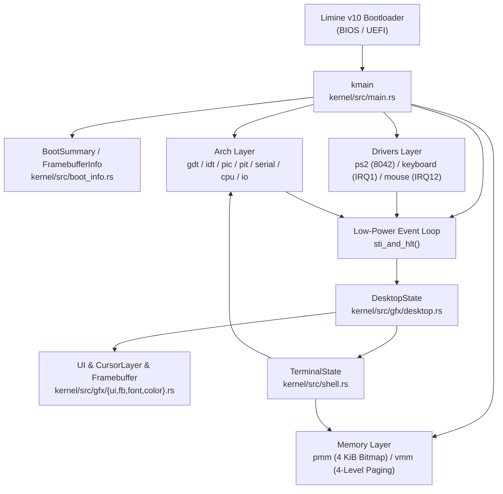
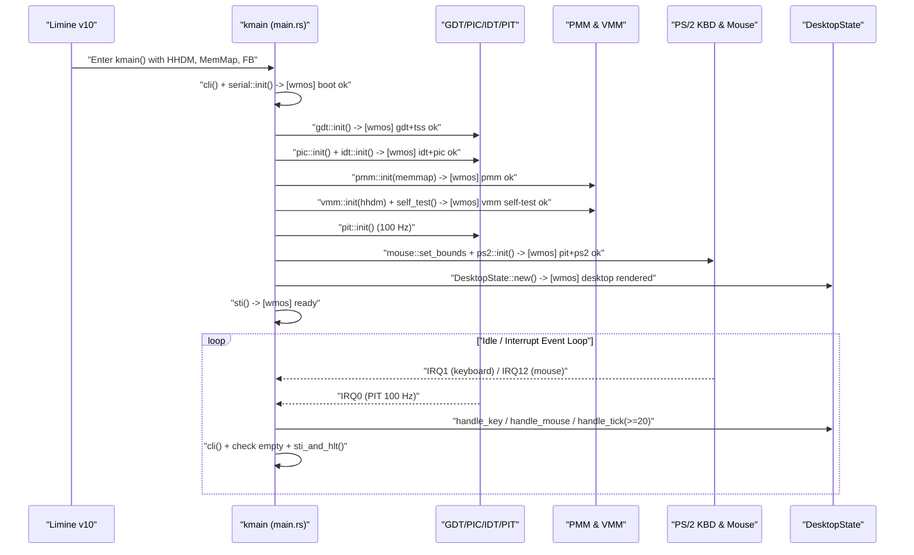

# WMOS (`v1.0.0-mvp`) 系统设计与架构文档

> 本文档严格对应仓库当前实现代码，所有地址、常数、数据结构、中断向量、串口标记与构建/验证流程均以实际源码为准。

---

## 1. 项目概览与工程定位

**WMOS**（`wmos-kernel` v0.1.0 / 里程碑 `v1.0.0-mvp`）是一个基于 **Rust Stable (`#![no_std]`, `#![no_main]`, `edition = "2021"`)** 与 **Limine v10 引导协议** 构建的独立 `x86_64` 微内核操作系统原型。

- **工程与工具链约束**：
  - 锁定工具链 `channel = "stable"`，目标三元组 `x86_64-unknown-none`（见 [rust-toolchain.toml](../rust-toolchain.toml)）。
  - 编译参数通过 [kernel/.cargo/config.toml](../kernel/.cargo/config.toml) 指定 `"-C", "relocation-model=static", "-C", "code-model=kernel"`；必须在 `kernel/` 目录内执行 `cargo build` 以确保 Cargo 加载该配置。
  - `panic = "abort"`，Release 配置 `opt-level = 2`、`lto = false`（见 [kernel/Cargo.toml](../kernel/Cargo.toml)）。
  - **纯整数无浮点**：内核及图形子系统严禁使用 `f32` / `f64`，渐变插值、进度条比例、坐标布局全部采用整数运算（含 `u128` 乘法避免溢出）。
  - **零堆分配**：未启用 `alloc` / 全局堆分配器，所有字符串格式化与终端缓冲区均依赖栈上定长结构（`StackBuf<N>`、`TermLine`）和静态全局缓冲区。
  - **禁用 nightly 特性**：中断入口采用 `core::arch::global_asm!` 手写保存/恢复 15 个通用寄存器，不使用 `extern "x86-interrupt"`。
- **研发与验证模式**：
  - 本地仅负责内核与脚本编写及 `cargo build --release` 静态编译与 ELF64 校验；
  - 完整系统镜像打包（ISO/IMG/QCOW2/VMDK/VHD）与真实虚拟化启动验证由 **GitHub Actions**（`ubuntu-latest`）中的 QEMU Legacy BIOS 与 UEFI (OVMF) 无头自动化流水线完成。

---

## 2. 系统总体分层架构

### 仓库目录与模块职责对照表

| 路径 | 职责说明 |
| :--- | :--- |
| [AGENTS.md](../AGENTS.md) | 仓库强制工程规范与代码-文档同步规则 |
| [README.md](../README.md) | 项目总览、产物下载及 QEMU/VirtualBox/VMware 运行指南 |
| [rust-toolchain.toml](../rust-toolchain.toml) | 锁定 Rust `stable` 工具链与 `x86_64-unknown-none` 目标 |
| [.gitignore](../.gitignore) | 忽略 `/kernel/target/`、`/dist/`、`/limine/`、`/iso_root/` 及镜像产物 |
| [.gitattributes](../.gitattributes) | 强制 `*.sh` 脚本在 Git 检出/提交时保持 LF (`\n`) |
| [.github/workflows/build.yml](../.github/workflows/build.yml) | GitHub Actions 自动编译、打包、QEMU 双模式验证与产物上传 |
| [boot/limine.conf](../boot/limine.conf) | Limine v10 引导配置（`timeout: 1`，`protocol: limine`，`boot():/boot/wmos-kernel`） |
| [docs/DESIGN.md](DESIGN.md) | 系统架构与核心子系统设计文档（本文档） |
| [docs/CHANGELOG.md](CHANGELOG.md) | 版本里程碑与变更追踪日志 |
| [scripts/build-images.sh](../scripts/build-images.sh) | 构建 `wmos.iso`、`wmos.img`、`wmos.qcow2`、`wmos.vmdk`、`wmos.vhd` 与 `SHA256SUMS.txt` |
| [scripts/verify-qemu.sh](../scripts/verify-qemu.sh) | 无头 QEMU BIOS/UEFI 日志断言、键鼠注入测试与 `boot-preview.png` 导出 |
| [kernel/Cargo.toml](../kernel/Cargo.toml) | `wmos-kernel` crate 元数据与 `limine = "0.5"` 依赖 |
| [kernel/.cargo/config.toml](../kernel/.cargo/config.toml) | 裸机目标与 `relocation-model=static`、`code-model=kernel` 编译参数 |
| [kernel/build.rs](../kernel/build.rs) | 传入 `-T kernel/linker-x86_64.ld` 链接参数并监听脚本变更 |
| [kernel/linker-x86_64.ld](../kernel/linker-x86_64.ld) | 高半核 ELF64 链接脚本（基址 `0xffffffff80000000`） |
| [kernel/src/main.rs](../kernel/src/main.rs) | Limine 请求定义、`kmain` 初始化序列、`sti_and_hlt` 主循环与 `panic_handler` |
| [kernel/src/boot_info.rs](../kernel/src/boot_info.rs) | `BootSummary` 与 `FramebufferInfo` 引导信息契约 |
| [kernel/src/shell.rs](../kernel/src/shell.rs) | `TerminalState` 终端状态机、18 行回滚缓冲区与 8 条内置命令 |
| [kernel/src/arch/mod.rs](../kernel/src/arch/mod.rs) | 架构层导出：`cpu`、`gdt`、`idt`、`io`、`pic`、`pit`、`serial` |
| [kernel/src/arch/io.rs](../kernel/src/arch/io.rs) | `inb`、`outb` 与 `0x80` 端口 `io_wait` |
| [kernel/src/arch/cpu.rs](../kernel/src/arch/cpu.rs) | `cli`、`sti`、`hlt`、`sti_and_hlt`、`halt_loop`、`rdtsc`、`read_cr3`、`invlpg`、`reboot` |
| [kernel/src/arch/serial.rs](../kernel/src/arch/serial.rs) | COM1 (`0x3F8`) 115200 8N1 串口驱动与 `serial_print!` / `serial_println!` |
| [kernel/src/arch/gdt.rs](../kernel/src/arch/gdt.rs) | 64 位 GDT、`Tss` 与 16 KiB `DOUBLE_FAULT_STACK`（IST1） |
| [kernel/src/arch/pic.rs](../kernel/src/arch/pic.rs) | 双 8259 PIC 重映射（`0x20`/`0x28`）、IRQ 掩码配置与 `send_eoi` |
| [kernel/src/arch/pit.rs](../kernel/src/arch/pit.rs) | 8254 PIT 通道 0（100 Hz）全局滴答计数 |
| [kernel/src/arch/idt.rs](../kernel/src/arch/idt.rs) | 256 项 IDT、`global_asm!` 中断桩与 `isr_dispatch` 分发器 |
| [kernel/src/mem/mod.rs](../kernel/src/mem/mod.rs) | 内存管理导出：`pmm`、`vmm` |
| [kernel/src/mem/pmm.rs](../kernel/src/mem/pmm.rs) | 128 KiB 物理页帧位图分配器（最高 4 GiB）与 `PmmStats` |
| [kernel/src/mem/vmm.rs](../kernel/src/mem/vmm.rs) | 4 级页表映射/解映射/地址翻译与开机读写自检 |
| [kernel/src/drivers/mod.rs](../kernel/src/drivers/mod.rs) | 设备驱动导出：`ps2`、`keyboard`、`mouse` |
| [kernel/src/drivers/ps2.rs](../kernel/src/drivers/ps2.rs) | 8042 PS/2 双端口控制器与鼠标流模式安全初始化 |
| [kernel/src/drivers/keyboard.rs](../kernel/src/drivers/keyboard.rs) | Set 1 + `0xE0` 键盘扫描码解码与 128 槽无锁 SPSC 队列 |
| [kernel/src/drivers/mouse.rs](../kernel/src/drivers/mouse.rs) | IRQ12 3 字节 PS/2 鼠标包同步解码与原子坐标状态 |
| [kernel/src/gfx/mod.rs](../kernel/src/gfx/mod.rs) | 图形层导出：`color`、`desktop`、`fb`、`font`、`ui` 及 `DesktopState` |
| [kernel/src/gfx/color.rs](../kernel/src/gfx/color.rs) | RGBX/BGRX 掩码打包与深靛蓝主题调色板常数 |
| [kernel/src/gfx/fb.rs](../kernel/src/gfx/fb.rs) | 32/24bpp `Framebuffer` 挥发性显存绘制与局部垂直渐变恢复 |
| [kernel/src/gfx/font.rs](../kernel/src/gfx/font.rs) | 95 字符 `0x20..=0x7E` 的 `8x8` 点阵字库 |
| [kernel/src/gfx/ui.rs](../kernel/src/gfx/ui.rs) | `StackBuf<N>`、`Window`、`draw_progress_bar` 与 `CursorLayer` |
| [kernel/src/gfx/desktop.rs](../kernel/src/gfx/desktop.rs) | `DesktopState` 窗口管理、Z 序切换、拖拽重绘与 20-tick 刷新 |

---

## 3. 内存空间与链接布局

### 3.1 高半核 ELF64 链接布局（`kernel/linker-x86_64.ld`）

- **目标格式与入口**：`OUTPUT_FORMAT(elf64-x86-64)`、`ENTRY(kmain)`。
- **高半核起始虚拟地址**：`. = 0xffffffff80000000;`（配合 `code-model=kernel` 处于高 2 GiB 地址空间）。
- **程序头 (`PHDRS`)**：定义 3 个 `PT_LOAD` 段：`text`、页对齐后的 `rodata`、页对齐后的 `data`（含 `.bss` 和 `COMMON`）。
- **Limine 请求段保护**：在 `.data` 段中显式保留：
  - `KEEP(*(.requests_start_marker))`
  - `KEEP(*(.requests))`
  - `KEEP(*(.requests_end_marker))`
- **丢弃段**：`/DISCARD/` 丢弃 `.eh_frame*` 与 `.note .note.*`。

### 3.2 Limine 请求与 HHDM 直映

[kernel/src/main.rs](../kernel/src/main.rs) 通过 `#[used]` 与 `#[link_section]` 注册 4 项 Limine 请求（夹在 `_START_MARKER` 与 `_END_MARKER` 之间）：

1. `BASE_REVISION: BaseRevision = BaseRevision::new()`
2. `FRAMEBUFFER_REQUEST: FramebufferRequest = FramebufferRequest::new()`
3. `MEMORY_MAP_REQUEST: MemoryMapRequest = MemoryMapRequest::new()`
4. `HHDM_REQUEST: HhdmRequest = HhdmRequest::new()`

`BootSummary::from_limine` 遍历 `memmap.entries()`：
- 将 `EntryType::USABLE` 同时计入 `usable_ram_bytes` 与 `total_ram_bytes`；
- 将 `EntryType::BOOTLOADER_RECLAIMABLE`、`EntryType::EXECUTABLE_AND_MODULES`、`EntryType::ACPI_RECLAIMABLE` 计入 `total_ram_bytes`。

HHDM（Higher Half Direct Map）偏移由 `hhdm_response.offset()` 获取（QEMU CI 实测为 `0xffff800000000000`），VMM 使用 `phys + hhdm()` 直接读写任意物理页表页帧。

### 3.3 物理页框分配器（PMM）与虚拟内存布局（VMM）

- **PMM 容量与保留区**（[kernel/src/mem/pmm.rs](../kernel/src/mem/pmm.rs)）：
  - `PAGE_SIZE = 4096`（4 KiB）
  - `BITMAP_WORDS = 16384`，`MAX_FRAMES = 16384 * 64 = 1_048_576`，`MAX_PHYS = 4 GiB`
  - `MIN_USABLE_PHYS = 0x10_0000`（1 MiB 以下低端物理内存保持置位已占用，永不分配）
  - 仅在 `EntryType::USABLE` 且对齐到 `[0x10_0000, 4 GiB)` 的页帧上清零位图位以标记空闲。
- **VMM 页表与自检地址范围**（[kernel/src/mem/vmm.rs](../kernel/src/mem/vmm.rs)）：
  - 标志位：`PRESENT = 1 << 0`、`WRITABLE = 1 << 1`、`NO_EXECUTE = 1 << 63`，并识别 `HUGE_PAGE = 1 << 7`、`ADDR_MASK = 0x000F_FFFF_FFFF_F000`。
  - `self_test()` 从虚拟基址 `TEST_BASE = 0xFFFF_9000_0000_0000` 起按 `4096` 步长扫描最多 `4096` 页（即 `0xFFFF_9000_0000_0000 .. 0xFFFF_9000_0100_0000`），寻找首个 `translate(candidate).is_none()` 的未映射虚拟页进行动态映射/读写/解映射验证。

---

## 4. 启动时序与串口状态契约

### 4.1 从引导移交到事件循环

### 4.2 COM1 串口驱动与状态标记契约

COM1（端口 `0x3F8`，[kernel/src/arch/serial.rs](../kernel/src/arch/serial.rs)）初始化为 `115200` 波特率（除数锁存低字节 `0x01`、高字节 `0x00`）、`8N1`（LCR `0x03`）、启用并清空 14 字节 FIFO（FCR `0xC7`），执行一次环回测试（MCR `0x1E` 发送 `0xAE`）后恢复 `MCR = 0x0F`；发送时轮询 LSR `0x20` 位并将 `'\n'` 转为 `"\r\n"`。

以下全部标记同时作为开发调试输出与 `scripts/verify-qemu.sh` 的 CI 自动化契约：

| 串口标记 | 输出位置 | 含义与验证要求 |
| :--- | :--- | :--- |
| `[wmos] boot ok` | `main.rs` | COM1 初始化完成，内核接管控制权（BIOS/UEFI 必检） |
| `[wmos] gdt+tss ok` | `main.rs` | 64 位 GDT、TSS 与 IST1 双重错误栈加载完成（BIOS/UEFI 必检） |
| `[wmos] idt+pic ok` | `main.rs` | 双 8259 PIC 重映射与 256 项 IDT 加载完成（BIOS/UEFI 必检） |
| `[wmos] pmm ok free=<n> total=<n> frames` | `main.rs` | PMM 位图初始化完成并输出空闲/总页框数（BIOS/UEFI 必检前缀 `[wmos] pmm ok`） |
| `[wmos] vmm self-test ok` | `main.rs` | VMM 4 级页表分配/写入/HHDM 对比/解映射自检通过（BIOS/UEFI 必检） |
| `[wmos] pit+ps2 ok` | `main.rs` | 100 Hz PIT 与 8042 PS/2 键鼠控制器初始化完成（BIOS/UEFI 必检） |
| `[wmos] limine rev=<r> hhdm=<hex>` | `main.rs` | 打印 Limine 协议版本号与 HHDM 基址 |
| `[wmos] memmap entries=<n> usable=<m> MiB total=<m> MiB` | `main.rs` | 打印物理内存表项数及可用/总内存 MiB |
| `[wmos] fb=<w>x<h> bpp=<b> pitch=
` | `main.rs` | 打印帧缓冲分辨率、位深与行距（BIOS/UEFI 必检前缀 `[wmos] fb=`） |
| `[wmos] desktop rendered` | `main.rs` | 桌面背景、窗口、任务栏与初始光标渲染完成（BIOS/UEFI 必检） |
| `[wmos] ready` | `main.rs` | 已执行 `sti()` 开启中断并进入事件循环（BIOS/UEFI 必检） |
| `[wmos] mouse active (<x>, <y>)` | `desktop.rs` | 首次收到鼠标有效数据包并触发桌面指针更新（UEFI 交互必检前缀 `[wmos] mouse active`） |
| `[wmos] cmd: <cmd>` | `shell.rs` | 终端收到非空命令并开始执行（UEFI 交互必检 `[wmos] cmd: help`） |
| `[wmos] reboot requested` | `shell.rs` | 用户在终端执行 `reboot` 命令 |
| `[wmos] EXCEPTION vec=<v> err=<e> rip=<r> rsp=<s>` | `idt.rs` | 捕获 CPU 异常 `0..=31` 并停机（BIOS/UEFI 严禁出现） |
| `[wmos] PANIC: <info>` | `main.rs` | 内核发生 Rust Panic 并停机（BIOS/UEFI 严禁出现） |

---

## 5. 核心子系统详细设计

### 5.1 架构层（`kernel/src/arch/`）

- **GDT 与 TSS（[gdt.rs](../kernel/src/arch/gdt.rs)）**：
  - 静态 `[u64; 5]` 全局描述符表：`0x00` Null、`0x08` 64 位内核代码段 (`0x00AF_9A00_0000_FFFF`)、`0x10` 内核数据段 (`0x00CF_9200_0000_FFFF`)、`0x18..0x20` 16 字节 64 位 TSS 描述符（类型 `0x89`）。
  - `Tss`（`#[repr(C, packed)]`）的 `ist[0]` 指向 16 KiB (`DOUBLE_FAULT_STACK_SIZE = 16 * 1024`)、16 字节对齐的 `DOUBLE_FAULT_STACK` 栈顶，`iomap_base = size_of::<Tss>()`。
  - 执行 `lgdt` 后通过 `push 0x08; lea rax, [rip + 2f]; push rax; retfq` 远返回刷新 `CS`，将 `DS/ES/FS/GS/SS` 重载为 `0x10`，最后 `ltr ax` 加载 `0x18`。
- **IDT 与汇编中断桩（[idt.rs](../kernel/src/arch/idt.rs)）**：
  - 256 项 `IdtTable`（`#[repr(C, align(16))]`），使用中断门 `GATE_INTERRUPT = 0x8E`、`KERNEL_CS = 0x08`；向量 `8`（Double Fault `#DF`）设置 `ist = 1` 使用独立 IST1 栈，防止内核栈溢出引发三重错误。
  - `global_asm!` 生成 `isr_stub_0..=47` 及 `isr_stub_unknown`（向量 `255`）：硬件压入错误码的向量 `8, 10, 11, 12, 13, 14, 17, 21, 29, 30` 使用 `ISR_ERR`，其余使用 `ISR_NOERR` 压入占位 `0`。
  - `isr_common` 压入 15 个通用寄存器（`rax` 到 `r15`），加上 CPU 硬件帧及 `vector`/`error_code` 共 22 个 `u64`，严格保持进入 `isr_dispatch(frame: &InterruptFrame)` 前的 16 字节栈对齐；返回时弹出 15 个寄存器、`add rsp, 16` 并执行 `iretq`。
  - 中断分发：`32` 调用 `pit::on_irq()` + `pic::send_eoi(0)`；`33` 调用 `keyboard::on_irq()` + `pic::send_eoi(1)`；`44` 调用 `mouse::on_irq()` + `pic::send_eoi(12)`；其余 `32..=47` 发送对应 `EOI`；`0..=31` 打印 `[wmos] EXCEPTION vec=<v> err=<e> rip=<r> rsp=<s>` 后 `cpu::halt_loop()`。
- **8259 PIC 与 PIT（[pic.rs](../kernel/src/arch/pic.rs), [pit.rs](../kernel/src/arch/pit.rs)）**：
  - 双 8259 PIC 按 ICW1=`0x11`、ICW4=`0x01` 初始化，主片重映射至 `0x20`（级联位 `0x04`）、从片重映射至 `0x28`（级联标识 `0x02`）。
  - IMR 掩码设置为主片 `0xF8`（开启 IRQ0 定时器、IRQ1 键盘、IRQ2 从片级联）与从片 `0xEF`（开启 IRQ12 鼠标）。`send_eoi(irq)` 在 `irq >= 8` 时同时向从片 `0xA0` 与主片 `0x20` 发送 `0x20`。
  - PIT 通道 0（端口 `0x40`）配置为命令字 `0x36`（方波模式 3），`HZ = 100`，分频系数 `1_193_182 / 100 = 11931`，原子计数器 `TICKS` 每 10 ms 递增一次。
- **原子休眠与重启（[cpu.rs](../kernel/src/arch/cpu.rs)）**：
  - `sti_and_hlt()` 将 `sti` 与 `hlt` 置于同一条 `asm!` 块中（利用 x86 `sti` 指令延迟一条指令才生效中断的硬件语义），确保条件检查后不会在开中断与休眠之间丢失唤醒中断。
  - `reboot()` 关中断后先等待 `0x64 & 0x02 == 0` 并向 `0x64` 发送 `0xFE` 触发 8042 复位；若 10,000 次 `io_wait()` 后仍未复位，则加载 `NullIdtr { limit: 0, base: 0 }` 并执行 `int3` 触发三重错误强制重启。

### 5.2 内存管理（`kernel/src/mem/`）

- **PMM（[pmm.rs](../kernel/src/mem/pmm.rs)）**：
  - 静态 `PmmLock` 使用 `IrqGuard` 保护：`pushfq` 保存 `IF` 位（`0x200`）-> `cli()` -> `AtomicBool` 自旋锁，释放时仅当进入前 `saved_if == true` 才恢复 `sti()`，避免在初始化或中断禁能区间误开中断。
  - `alloc_frame()` 从 `next_hint` 起循环扫描 `BITMAP_WORDS`，对非全 1 字使用 `(!word).trailing_zeros()` 定位空闲位，置位后更新 `free_frames` 与 `next_hint`；`free_frame(phys)` 校验 4 KiB 对齐及 `[MIN_USABLE_PHYS, MAX_PHYS)` 范围，归还后前移 `next_hint`。
- **VMM（[vmm.rs](../kernel/src/mem/vmm.rs)）**：
  - `indices(virt)` 抽取虚拟地址 `[47:39]`、`[38:30]`、`[29:21]`、`[20:12]` 四级索引。
  - `map_page` 遍历 CR3 指向的四级页表，缺失中间表时通过 `pmm::alloc_frame()` 分配并借助 `table_mut`（`phys + hhdm()`）清零写入 `PRESENT | WRITABLE`，若遇到 `HUGE_PAGE` 或目标页已映射则报错返回，映射后执行 `cpu::invlpg(virt)`。
  - `unmap_page` 清除叶子 PTE 并执行 `invlpg(virt)`；`translate` 支持 4 KiB 页及 1 GiB / 2 MiB 大页路径解析。

### 5.3 驱动层（`kernel/src/drivers/`）

- **8042 PS/2 控制器初始化顺序（[ps2.rs](../kernel/src/drivers/ps2.rs)）**：
  1. `flush()` 清空 8042 输出缓冲；
  2. 发送 `0xAD` 与 `0xA7` 禁用第一/第二 PS/2 端口并再次 `flush()`；
  3. 通过 `0x20` 读取配置字节 `base_cfg`（读取超时回退 `0x44`），写入 `init_cfg = (base_cfg | 0x40) & !0x33`——开启扫描码 Set 1 转换（bit 6）、开启双端口时钟（清除 bits 4..5），并**刻意屏蔽 IRQ1 与 IRQ12（bits 0..1 清零）**；
  4. 发送 `0xAE` / `0xA8` 重新使能键盘与鼠标端口；
  5. 在中断屏蔽状态下通过 `0xD4` 前缀向鼠标发送 `0xF6`（恢复默认参数）与 `0xF4`（开启流式上报），读取并丢弃 `0xFA` ACK 后执行 `flush()`；
  6. 最后写入 `final_cfg = init_cfg | 0x03` 开启 IRQ1 与 IRQ12，再执行一次 `flush()`。
  - **关键设计原因**：若在发送 `0xF6` / `0xF4` 之前开启 `cfg` 的 IRQ12（bit 1），命令返回 `0xFA` 时 8042 会向 8259 PIC 锁存一次边缘触发的 IRQ12；即使 `ps2::init()` 随后在 `cli()` 下读走了 `0xFA`，当内核执行 `sti()` 后 PIC 仍会投递这枚陈旧 IRQ12，导致驱动读取到残留字节 `0xFA` 并破坏 3 字节鼠标包同步。先配置后开中断彻底消除了该问题。
- **PS/2 键盘驱动（[keyboard.rs](../kernel/src/drivers/keyboard.rs)）**：
  - `on_irq()` 读取状态口 `0x64`，仅当 `(status & 0x01) != 0 && (status & 0x20) == 0`（输出缓冲区满且非鼠标辅助设备数据）时才读取 `0x60` 扫描码并递增 `KEY_IRQ_COUNT`。
  - 支持 `0xE0` 扩展前缀（`0x48/0x50/0x4B/0x4D` 映射 `Up/Down/Left/Right`）、左右 Shift（`0x2A/0xAA`、`0x36/0xB6`）、CapsLock（`0x3A` 翻转）、`Escape`（`0x01`）、`Backspace`（`0x0E`）、`Tab`（`0x0F`）、`Enter`（`0x1C`）及 `NORMAL_MAP` / `SHIFT_MAP`（长度 89）的 ASCII 解码。
  - 事件写入容量 `QUEUE_CAP = 128` 的单生产者单消费者（SPSC）无锁环形队列 `KEY_QUEUE`。
- **PS/2 鼠标驱动（[mouse.rs](../kernel/src/drivers/mouse.rs)）**：
  - `on_irq()` 读取 `0x64` 并严格校验 `(status & 0x21) == 0x21`（`OBF` 与 `AUX_OBF` 同时置位），拒绝无数据或属于键盘的伪中断。
  - 在 `PACKET_CYCLE == 0` 时要求 `(byte & 0xC8) == 0x08`（bit 3 同步位必须为 1 且 bits 6..7 X/Y 溢出位必须为 0），避免 `0xFA` 等异常字节劫持包首对齐。
  - 收齐 3 字节 `(b0, b1, b2)` 后完成 9 位符号扩展（`dx = b1 - ((b0 & 0x10) << 4)`，`dy = b2 - ((b0 & 0x20) << 3)`）、屏幕 Y 轴向下翻转（`y - dy`）与边界钳位，原子更新 `PACKED_STATE: AtomicU64`（`x` 24 位、`y` 24 位、`buttons` 8 位）并置位 `MOUSE_DIRTY`。初始光标位于 `(w * 56 / 100, h * 45 / 100)`。

### 5.4 图形桌面与交互终端（`kernel/src/gfx/` & `kernel/src/shell.rs`）

- **色彩与帧缓冲（[color.rs](../kernel/src/gfx/color.rs), [fb.rs](../kernel/src/gfx/fb.rs)）**：
  - `Color::pack(&FramebufferInfo)` 根据固件上报的 `red/green/blue_mask_size` 与 `mask_shift` 动态打包像素，兼容 RGBX/BGRX 与非 8-bit 通道布局。
  - `Framebuffer` 支持 `32bpp`（优先 4 字节对齐 `write_volatile::<u32>`）与 `24bpp`，提供 `fill_gradient_v` 与 `fill_gradient_v_region`（窗口拖拽还原背景时按全局 `work_h` 高度精确计算每行渐变色，避免视觉接缝）。
- **字体与 UI 组件（[font.rs](../kernel/src/gfx/font.rs), [ui.rs](../kernel/src/gfx/ui.rs)）**：
  - `font.rs` 内置 `0x20..=0x7E` 共 95 个字符的 `8x8` 位图数据，未覆盖字符回退空心矩形框。
  - `Window`（`TITLE_BAR_H = 26`、`BORDER_W = 1`、4px 投影、红/黄/绿三圆点、活跃态边框高亮）提供 `hit_test` 与 `title_bar_hit_test`。
  - `CursorLayer` 维护 `12x16` `CURSOR_BITMAP` 与 `saved_bg: [u32; 192]` 显存快照：每次光标移动或任何窗口/任务栏局部刷新前均先 `restore` 还原指针下方的原始像素，绘制完成后再 `save_and_draw`，消除光标残影。
- **桌面管理器（[desktop.rs](../kernel/src/gfx/desktop.rs)）**：
  - 管理两个窗口：`wins[0]` 为 `System Info`，`wins[1]` 为 `WMOS Terminal`，初始 `z_order = [0, 1]`（终端默认置顶激活）。
  - 底部 `TASKBAR_H = 36` 任务栏包含 `WMOS` 标识块、`[System Info]`（`x=80, w=116`）与 `[WMOS Terminal]`（`x=204, w=132`）标签，以及右侧实时托盘 `UP HH:MM:SS | (x,y)`。
  - 支持点击窗口置顶、点击任务栏标签切换焦点、按住标题栏拖拽并恢复旧区域背景；每 `20` PIT ticks（`200 ms`）增量刷新 `System Info` 统计、任务栏运行时间与终端光标闪烁（`50` ticks / `500 ms` 周期）。
- **交互式终端（[shell.rs](../kernel/src/shell.rs)）**：
  - `TerminalState` 维护 `MAX_LINES = 18` 行、`MAX_LINE_LEN = 88` 字节环形缓冲区及 `MAX_INPUT_LEN = 64` 字节输入行；启动时预置引导与分辨率摘要及 `Type 'help' for commands.` 提示。
  - 内置 8 条命令：`help`、`info`、`mem`（实时调用 `pmm::stats()` 与 `vmm::self_test()`）、`uptime`（显示 PIT 时间与 KBD/Mouse IRQ 计数）、`echo <text>`、`clear`、`about`、`reboot`。

---

## 6. 构建、多格式镜像与云端 QEMU 校验体系

### 6.1 CI 工作流（[.github/workflows/build.yml](../.github/workflows/build.yml)）

在 `push`、`pull_request` 与 `workflow_dispatch` 时于 `ubuntu-latest` 执行 `build-and-verify` 任务：
1. 安装 `xorriso`、`mtools`、`gdisk`、`qemu-utils`、`qemu-system-x86`、`ovmf`、`build-essential`、`python3`；
2. 安装 Rust `stable` 与 `x86_64-unknown-none` 目标并配置 `Swatinem/rust-cache@v2`（`workspaces: "kernel -> target"`）；
3. 在 `working-directory: kernel` 下执行 `cargo build --release`；
4. 运行 `./scripts/build-images.sh` 打包镜像；
5. 运行 `./scripts/verify-qemu.sh` 执行 QEMU BIOS + UEFI 双模式与交互验证；
6. 上传 `wmos-images`（5 种镜像 + `SHA256SUMS.txt`）与 `wmos-ci-logs-and-preview`（`if: always()` 上传 BIOS/UEFI 串口日志及 `boot-preview.png`）。

### 6.2 多格式镜像打包（[scripts/build-images.sh](../scripts/build-images.sh)）

- **Limine 获取**：若 `limine/limine` 不存在，克隆 `https://github.com/limine-bootloader/limine.git --branch=v10.x-binary --depth=1` 并编译 `make -C limine`。
- **Hybrid BIOS + UEFI ISO (`dist/wmos.iso`)**：写入 `iso_root/boot/wmos-kernel`、`iso_root/boot/limine/limine.conf`、Limine BIOS/UEFI 引导文件与 `EFI/BOOT/{BOOTX64.EFI,BOOTIA32.EFI}`，使用 `xorriso -as mkisofs` 生成混合 ISO 后执行 `./limine/limine bios-install dist/wmos.iso`。
- **64 MiB GPT 原始磁盘镜像 (`dist/wmos.img`)**：
  - 使用 `sgdisk` 建立两个 GPT 分区：
    - 分区 1（`2048..4095`，类型 `ef02` BIOS Boot Partition）供 `./limine/limine bios-install dist/wmos.img 1` 写入第二阶段引导代码；
    - 分区 2（`4096..+60M`，偏移 `2 MiB`，类型 `ef00` EFI System Partition）使用 `mformat -i dist/wmos.img@@2M -T 122880 -F ::` 格式化为 FAT32 并拷入内核、`limine.conf` 与 BIOS/UEFI 引导文件。
- **虚拟机镜像转换与校验**：`qemu-img convert` 生成 `wmos.qcow2`（QCOW2）、`wmos.vmdk`（VMDK）与 `wmos.vhd`（固定大小 VPC/VHD），并在 `dist/` 生成 `SHA256SUMS.txt`。

### 6.3 QEMU 无头双模式与交互校验（[scripts/verify-qemu.sh](../scripts/verify-qemu.sh)）

1. **Legacy BIOS 模式**：`timeout 12s qemu-system-x86_64 -M q35 -m 256M -cdrom dist/wmos.iso -boot d -display none -serial file:dist/qemu-bios.log -no-reboot -no-shutdown`，预期以 `124`（超时正常停机）或 `0` 退出。
2. **UEFI (OVMF) 模式**：自动探测 `/usr/share/OVMF/OVMF_CODE_4M.fd` 等路径启动后台 QEMU，开启 `-vga std` 与 `-monitor unix:/tmp/wmos-mon.sock,server,nowait`。
3. **自动键鼠交互注入与截图**：轮询 `dist/qemu-uefi.log` 出现 `[wmos] ready` 后，通过 Python Unix Socket 连接 QEMU Monitor 依次发送 `mouse_move 40 25` 与 `sendkey h` / `e` / `l` / `p` / `ret`（间隔约 `0.08s`），轮询日志确认 `[wmos] cmd: help` 出现后发送 `screendump dist/boot-preview.ppm`，使用纯 Python 标准库（`zlib` + `struct`）解析 PPM P6 并编码输出 `dist/boot-preview.png`。
4. **日志断言**：严格校验 BIOS 与 UEFI 两份串口日志均包含全部 9 项启动标记且不含 `[wmos] PANIC` / `[wmos] EXCEPTION`，同时校验 UEFI 日志额外包含 `[wmos] mouse active` 与 `[wmos] cmd: help`。

---

## 7. 已知边界与后续演进路线

### 当前已知边界（`v1.0.0-mvp`）

- **单核运行**：仅在 BSP（引导处理器）运行，尚未启用 SMP 多核唤醒。
- **传统中断与存储**：使用 8259 PIC 与 PIT 100 Hz，尚未切换 APIC / HPET / TSC-Deadline，无磁盘块设备或文件系统驱动。
- **静态内存上限与布局**：PMM 位图固定覆盖最高 `4 GiB` 物理地址；未引入堆分配器（`alloc`），桌面固定管理 2 个内置窗口，仅支持 Ring 0 内核态执行。

### 后续演进路线

- **第 1 梯队（内存与任务调度基础）**：
  - 引入基于空闲页框链表的可扩展 PMM（突破 4 GiB 静态位图限制）与内核堆分配器（`linked_list_allocator` / slab），启用 Rust `alloc`。
  - 实现多核上下文切换与抢占式内核线程调度器，迁移至 Local APIC + IOAPIC 与 ACPI 表解析。
- **第 2 梯队（用户态隔离与系统调用）**：
  - 在 GDT/TSS 中补全 Ring 3 用户代码/数据段与 `TSS.rsp[0]` 特权级切换栈。
  - 实现 `syscall/sysret` 快速系统调用接口与用户态进程地址空间隔离（独立 PML4）。
- **第 3 梯队（设备生态、存储与窗口合成）**：
  - 增加 PCIe 枚举、VirtIO-Blk / NVMe 块设备与 FAT32 / VFS 读写挂载。
  - 将桌面从直接前缓冲局部重绘升级为离屏双缓冲窗口合成器，支持动态创建/关闭窗口及用户态 GUI 应用进程。

---

## 8. 文档同步维护规范

本仓库实行**代码与文档强一致**规范（详见 [AGENTS.md](../AGENTS.md)）：

- 凡修改任何内核源码、链接脚本、Limine 配置、打包/校验脚本或 CI 工作流，**必须在同一提交中**同步更新：
  1. [docs/DESIGN.md](DESIGN.md)：同步更新涉及的架构图、内存/中断/串口契约、子系统实现细节或已知边界；
  2. [docs/CHANGELOG.md](CHANGELOG.md)：追加版本或变更记录（含日期、改动文件与验证依据）；
  3. [README.md](../README.md)：当改动影响用户可见特性、终端命令、目录结构或构建/运行方式时同步更新。
