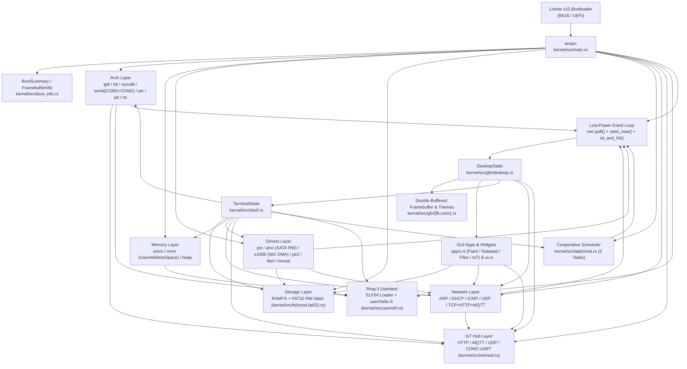
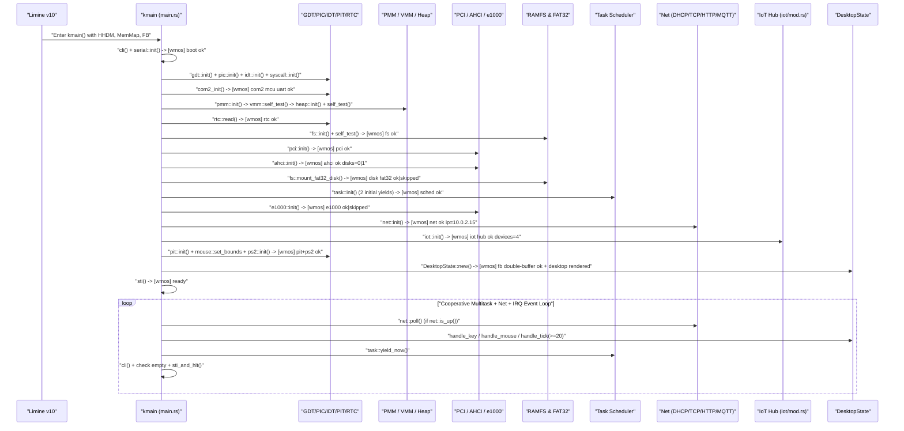

# WMOS (`v5.0.0`) 系统设计与架构文档

> 本文档严格对应仓库当前实现代码，所有地址、常数、数据结构、中断向量、串口标记与构建/验证流程均以实际源码为准。

---

## 1. 项目概览与工程定位

**WMOS**（crate `wmos-kernel` v0.1.0 / 里程碑 `v5.0.0`）是一个基于 **Rust Stable (`#![no_std]`, `#![no_main]`, `edition = "2021"`)** 与 **Limine v10 引导协议** 构建的独立 `x86_64` 微内核桌面操作系统。

- **工程与工具链约束**：
  - 锁定工具链 `channel = "stable"`，目标三元组 `x86_64-unknown-none`（见 [rust-toolchain.toml](../rust-toolchain.toml)）。
  - 编译参数通过 [kernel/.cargo/config.toml](../kernel/.cargo/config.toml) 指定 `"-C", "relocation-model=static", "-C", "code-model=kernel"`；必须在 `kernel/` 目录内执行 `cargo build` 以确保 Cargo 加载该配置。
  - `panic = "abort"`，Release 配置 `opt-level = 2`、`lto = false`（见 [kernel/Cargo.toml](../kernel/Cargo.toml)）。
  - **纯整数无浮点**：内核及图形子系统严禁使用 `f32` / `f64`，渐变插值、进度条比例、Bresenham 光栅化与坐标布局全部采用整数运算（含 `u128` 乘法避免溢出）。
  - **动态堆分配 (`extern crate alloc`)**：通过 [kernel/src/mem/heap.rs](../kernel/src/mem/heap.rs) 提供 IRQ 安全合并式自由链表全局分配器，支撑 `Box`、`Vec`、`String`、`BTreeMap`、RAM 双缓冲帧缓存、FAT32 索引、任务内核栈与 RAMFS。
  - **禁用 nightly 特性**：中断入口（[kernel/src/arch/idt.rs](../kernel/src/arch/idt.rs)）与协作式上下文切换（[kernel/src/task/mod.rs](../kernel/src/task/mod.rs)）均采用 `core::arch::global_asm!` 实现，不使用 `extern "x86-interrupt"` 或 `#[alloc_error_handler]`。
- **研发与验证模式**：
  - 本地负责内核与脚本编写及 `cargo build --release` 静态编译与 ELF64 校验；
  - 完整系统镜像打包（ISO/IMG/QCOW2/VMDK/VHD）与虚拟化启动交互验证由 **GitHub Actions**（`ubuntu-latest`）中的 QEMU Legacy BIOS 与 UEFI (OVMF) 无头自动化流水线完成。

---

## 2. 系统总体分层架构

### 仓库目录与模块职责对照表

| 路径 | 职责说明 |
| :--- | :--- |
| [AGENTS.md](../AGENTS.md) | 仓库强制工程规范与代码-文档同步规则 |
| [README.md](../README.md) | 项目总览、产物下载及 QEMU/VirtualBox/VMware 运行指南 |
| [rust-toolchain.toml](../rust-toolchain.toml) | 锁定 Rust `stable` 工具链与 `x86_64-unknown-none` 目标 |
| [.gitignore](../.gitignore) | 忽略 `/kernel/target/`、`/dist/`、`/limine/`、`/iso_root/` 及镜像产物 |
| [.gitattributes](../.gitattributes) | 强制 `*.sh` 脚本在 Git 检出/提交时保持 LF (`\n`) |
| [.github/workflows/build.yml](../.github/workflows/build.yml) | GitHub Actions 自动编译、打包、QEMU 双模式验证、产物上传与 `v*` 标签 Release 自动发布 |
| [boot/limine.conf](../boot/limine.conf) | Limine v10 引导配置（`timeout: 1`，`protocol: limine`，`boot():/boot/wmos-kernel`） |
| [docs/DESIGN.md](DESIGN.md) | 系统架构与核心子系统设计文档（本文档） |
| [docs/CHANGELOG.md](CHANGELOG.md) | 版本里程碑与变更追踪日志 |
| [scripts/build-images.sh](../scripts/build-images.sh) | 编译链接 `user/hello.S` 为 `dist/hello.elf` 并构建 `wmos.iso`、`wmos.img`、`wmos.qcow2`、`wmos.vmdk`、`wmos.vhd` 与 `SHA256SUMS.txt` |
| [scripts/verify-qemu.sh](../scripts/verify-qemu.sh) | 无头 QEMU BIOS/UEFI（含 SATA 持久化、冷重启、e1000/DHCP/HTTP/MQTT/UDP/COM2 MCU 与 Ring-3 `exec`）断言与 `boot-preview.png` 导出 |
| [user/hello.S](../user/hello.S) | 独立 Ring-3 x86_64 AT&T 汇编用户程序（链接至 `0x400000` 并打包为 `/bin/hello.elf`） |
| [kernel/Cargo.toml](../kernel/Cargo.toml) | `wmos-kernel` crate 元数据与 `limine = "0.5"` 依赖 |
| [kernel/.cargo/config.toml](../kernel/.cargo/config.toml) | 裸机目标与 `relocation-model=static`、`code-model=kernel` 编译参数 |
| [kernel/build.rs](../kernel/build.rs) | 传入 `-T kernel/linker-x86_64.ld` 链接参数并监听脚本变更 |
| [kernel/linker-x86_64.ld](../kernel/linker-x86_64.ld) | 高半核 ELF64 链接脚本（基址 `0xffffffff80000000`） |
| [kernel/src/main.rs](../kernel/src/main.rs) | `kmain` 初始化序列（含 `com2_init` / `iot::init`）、`net::poll()`、`task::yield_now()` + `sti_and_hlt()` 主循环与 `panic_handler` |
| [kernel/src/boot_info.rs](../kernel/src/boot_info.rs) | `BootSummary` 与 `FramebufferInfo` 引导信息契约 |
| [kernel/src/shell.rs](../kernel/src/shell.rs) | `TerminalState`、64 条命令历史、Tab 补全、`ShellAction` 与 32 条内置命令（含 `dhcp`/`ipset`/`http`/`mqtt`/`mcu`/`iot`/`exec`） |
| [kernel/src/task/mod.rs](../kernel/src/task/mod.rs) | 3 任务协作式调度器、`global_asm!` 上下文切换与 `TaskInfo` |
| [kernel/src/user/mod.rs](../kernel/src/user/mod.rs) | 用户态子系统导出：`elf` |
| [kernel/src/user/elf.rs](../kernel/src/user/elf.rs) | ELF64 `ET_EXEC` 加载器、`UserAddressSpace` 隔离、16 KiB 用户栈与 `ExecOutput` / `run_elf` |
| [kernel/src/net/mod.rs](../kernel/src/net/mod.rs) | `NetConfig`、IPv4/ARP/DHCPv4/ICMP/UDP 协议栈与 `dhcp_acquire` / `udp_exchange` / `ping` |
| [kernel/src/net/tcp.rs](../kernel/src/net/tcp.rs) | 同步 `TcpStream` 状态机、RFC 1071 TCP 伪首部校验和、`http_get` 与 MQTT 3.1.1 `mqtt_publish` |
| [kernel/src/iot/mod.rs](../kernel/src/iot/mod.rs) | IoT 设备注册表与统一控制总线（`DeviceKind`、`SmartDevice`、`toggle`、`mcu_send`、`set_endpoint`） |
| [kernel/src/fs/mod.rs](../kernel/src/fs/mod.rs) | 统一文件系统层：可读写 RAMFS 与根目录 `/disk/<8.3>` FAT32 持久化挂载（子目录写保护） |
| [kernel/src/fs/fat32.rs](../kernel/src/fs/fat32.rs) | GPT (`EFI PART`, `ef00`) 与 FAT32 BPB/簇链/LFN+8.3 读写及根目录文件增删驱动 |
| [kernel/src/arch/mod.rs](../kernel/src/arch/mod.rs) | 架构层导出：`cpu`、`gdt`、`idt`、`io`、`pic`、`pit`、`rtc`、`serial`、`syscall` |
| [kernel/src/arch/io.rs](../kernel/src/arch/io.rs) | 端口 I/O：`inb`、`outb`、`inw`、`outw`、`inl`、`outl` 与 `io_wait` |
| [kernel/src/arch/cpu.rs](../kernel/src/arch/cpu.rs) | `cli`、`sti`、`hlt`、`sti_and_hlt`、`halt_loop`、`rdtsc`、`read_cr3`、`invlpg`、`reboot`、`shutdown` |
| [kernel/src/arch/serial.rs](../kernel/src/arch/serial.rs) | COM1 (`0x3F8`) 内核串口日志与 COM2 (`0x2F8`) 115200 8N1 外部 MCU 行通信驱动 |
| [kernel/src/arch/gdt.rs](../kernel/src/arch/gdt.rs) | 7 项 64 位 GDT（含 `USER_DS`/`USER_CS`）、`Tss`、`TSS_RSP0_STACK` 与 `DOUBLE_FAULT_STACK`（IST1） |
| [kernel/src/arch/pic.rs](../kernel/src/arch/pic.rs) | 双 8259 PIC 重映射（`0x20`/`0x28`）、IRQ 掩码配置与 `send_eoi` |
| [kernel/src/arch/pit.rs](../kernel/src/arch/pit.rs) | 8254 PIT 通道 0（100 Hz）全局滴答计数 |
| [kernel/src/arch/rtc.rs](../kernel/src/arch/rtc.rs) | CMOS (`0x70`/`0x71`) 实时时钟 `RtcDateTime` 读取与 BCD/12h 解码 |
| [kernel/src/arch/idt.rs](../kernel/src/arch/idt.rs) | 256 项 IDT、`global_asm!` 中断桩、`isr_dispatch` 与 CPL=3 用户态异常隔离恢复 |
| [kernel/src/arch/syscall.rs](../kernel/src/arch/syscall.rs) | `IA32_EFER.SCE`/`STAR`/`LSTAR`/`FMASK` 配置、16 KiB `SYSCALL_STACK`、`global_asm!` 快速系统调用与用户态进出蹦床 |
| [kernel/src/mem/mod.rs](../kernel/src/mem/mod.rs) | 内存管理导出：`heap`、`pmm`、`vmm` |
| [kernel/src/mem/pmm.rs](../kernel/src/mem/pmm.rs) | 128 KiB 物理页帧位图分配器（最高 4 GiB）与 `PmmStats` |
| [kernel/src/mem/vmm.rs](../kernel/src/mem/vmm.rs) | 4 级页表映射/解映射、`USER_ACCESSIBLE`、`UserAddressSpace` 隔离与自检 |
| [kernel/src/mem/heap.rs](../kernel/src/mem/heap.rs) | `HEAP_START` 内核堆映射、`#[global_allocator]` 与自检 |
| [kernel/src/drivers/mod.rs](../kernel/src/drivers/mod.rs) | 设备驱动导出：`ahci`、`e1000`、`keyboard`、`mouse`、`pci`、`ps2` |
| [kernel/src/drivers/pci.rs](../kernel/src/drivers/pci.rs) | PCI 配置空间（`0xCF8`/`0xCFC`）总线 `0..=7` 设备枚举（含 `bar0`/`bar5`）与厂商/类别映射 |
| [kernel/src/drivers/ahci.rs](../kernel/src/drivers/ahci.rs) | AHCI SATA 控制器 DMA 读写驱动（`IDENTIFY 0xEC`、`READ_DMA_EXT 0x25`、`WRITE_DMA_EXT 0x35`、`FLUSH_CACHE_EXT 0xEA`） |
| [kernel/src/drivers/e1000.rs](../kernel/src/drivers/e1000.rs) | Intel e1000/e1000e NIC DMA 驱动（MMIO 128 KiB、16 槽 RX/TX 环与 `NicInfo`） |
| [kernel/src/drivers/ps2.rs](../kernel/src/drivers/ps2.rs) | 8042 PS/2 双端口控制器与鼠标流模式安全初始化 |
| [kernel/src/drivers/keyboard.rs](../kernel/src/drivers/keyboard.rs) | Set 1 + `0xE0` 键盘扫描码解码与 128 槽无锁 SPSC 队列 |
| [kernel/src/drivers/mouse.rs](../kernel/src/drivers/mouse.rs) | IRQ12 3 字节 PS/2 鼠标包同步解码与原子坐标状态 |
| [kernel/src/gfx/mod.rs](../kernel/src/gfx/mod.rs) | 图形层导出：`apps`、`color`、`desktop`、`fb`、`font`、`ui` 及 `DesktopState` |
| [kernel/src/gfx/color.rs](../kernel/src/gfx/color.rs) | RGBX/BGRX 掩码打包、调色板常数与 `Theme::{Dark, Ocean, Amber}` |
| [kernel/src/gfx/fb.rs](../kernel/src/gfx/fb.rs) | 双缓冲 RAM 帧缓存、`present_rect`/`present_all` MMIO 刷新与 Bresenham `draw_line` |
| [kernel/src/gfx/font.rs](../kernel/src/gfx/font.rs) | 95 字符 `0x20..=0x7E` 的 `8x8` 点阵字库 |
| [kernel/src/gfx/ui.rs](../kernel/src/gfx/ui.rs) | `StackBuf<N>`、`Window`、`WindowButton`、`draw_progress_bar` 与 `CursorLayer` |
| [kernel/src/gfx/apps.rs](../kernel/src/gfx/apps.rs) | `PaintApp` 画板、`NotepadApp` 编辑器、`FilesApp` 文件管理器与 `IotApp` 智能家居控制台 |
| [kernel/src/gfx/desktop.rs](../kernel/src/gfx/desktop.rs) | `DesktopState` 6 窗口管理、9 项 Start 菜单、主题切换、动态任务栏与实时监控 |

---

## 3. 内存空间与链接布局

### 3.1 高半核 ELF64 链接布局（`kernel/linker-x86_64.ld`）

- **目标格式与入口**：`OUTPUT_FORMAT(elf64-x86-64)`、`ENTRY(kmain)`。
- **高半核起始虚拟地址**：`. = 0xffffffff80000000;`（配合 `code-model=kernel` 处于高 2 GiB 地址空间）。
- **程序头 (`PHDRS`)**：3 个 `PT_LOAD` 段：`text`、页对齐后的 `rodata`、页对齐后的 `data`（含 `.bss` 和 `COMMON`）。
- **Limine 请求段保护**：在 `.data` 段中显式保留 `KEEP(*(.requests_start_marker))`、`KEEP(*(.requests))`、`KEEP(*(.requests_end_marker))`，并丢弃 `.eh_frame*` 与 `.note .note.*`。

### 3.2 Limine 请求、PMM、VMM、Heap 与 MMIO 虚拟地址布局

[kernel/src/main.rs](../kernel/src/main.rs) 注册 4 项 Limine 请求（`BASE_REVISION`、`FRAMEBUFFER_REQUEST`、`MEMORY_MAP_REQUEST`、`HHDM_REQUEST`），`BootSummary::from_limine` 统计 `usable_ram_bytes` 与 `total_ram_bytes`。

| 虚拟/物理地址空间 | 用途与容量参数 | 定义位置 |
| :--- | :--- | :--- |
| `0x0000_0000_0040_0000` .. `< 0x0000_7000_0000_0000` (`USER_ADDR_CEIL`) | Ring-3 用户态 ELF64 `PT_LOAD` 隔离映射区（低半部每进程独立 PML4 + `USER_ACCESSIBLE`） | [kernel/src/user/elf.rs](../kernel/src/user/elf.rs) |
| `0x0000_7FFF_F000_0000` .. `0x0000_7FFF_F000_4000` (`USER_STACK_BASE`, 4 页 = 16 KiB) | Ring-3 用户态隔离栈区（初始 `USER_RSP_INIT = 0x0000_7FFF_F000_3FF0`，16 字节对齐） | [kernel/src/user/elf.rs](../kernel/src/user/elf.rs) |
| `0x0000_0000_0010_0000` (`MIN_USABLE_PHYS`) .. `4 GiB` (`MAX_PHYS`) | PMM 4 KiB 页帧位图管理区（`[u64; 16384]` = 128 KiB，最多 `1_048_576` 帧，1 MiB 以下保留） | [kernel/src/mem/pmm.rs](../kernel/src/mem/pmm.rs) |
| `0xffff_8000_0000_0000` (HHDM 基址) | Limine 物理内存直映区，供 VMM 访问四级页表及 AHCI 访问物理 DMA 帧 | [kernel/src/mem/vmm.rs](../kernel/src/mem/vmm.rs) |
| `0xffff_9000_0000_0000` (`TEST_BASE`, 最多扫描 4096 页) | VMM `self_test()` 动态映射/写入 `0x574D_4F53_CAFE_BABE`/解映射测试虚址段 | [kernel/src/mem/vmm.rs](../kernel/src/mem/vmm.rs) |
| `0xffff_a000_0000_0000` (`HEAP_START`, 2 MiB .. 16 MiB) | 内核堆区（`MIN_PAGES = 512` .. `MAX_PAGES = 4096`，映射 `PRESENT \| WRITABLE`） | [kernel/src/mem/heap.rs](../kernel/src/mem/heap.rs) |
| `0xffff_b000_0000_0000` (`AHCI_MMIO_VIRT`, 2 页 = 8 KiB) | AHCI HBA BAR5 寄存器映射区（`PRESENT \| WRITABLE \| WRITE_THROUGH \| CACHE_DISABLE`） | [kernel/src/drivers/ahci.rs](../kernel/src/drivers/ahci.rs) |
| `0xffff_b001_0000_0000` (`E1000_MMIO_VIRT`, 32 页 = 128 KiB) | Intel e1000 NIC BAR0 寄存器映射区（`PRESENT \| WRITABLE \| WRITE_THROUGH \| CACHE_DISABLE`） | [kernel/src/drivers/e1000.rs](../kernel/src/drivers/e1000.rs) |
| `0xffff_ffff_8000_0000` | 内核 ELF64 高半核代码/只读数据/数据/BSS 映射基址 | [kernel/linker-x86_64.ld](../kernel/linker-x86_64.ld) |

---

## 4. 启动时序与串口状态契约

### 4.1 从引导移交到调度事件循环

### 4.2 COM1 串口驱动与状态标记契约

COM1（端口 `0x3F8`，[kernel/src/arch/serial.rs](../kernel/src/arch/serial.rs)）初始化为 `115200` 波特率、`8N1`、14 字节 FIFO（`0xC7`），执行环回自检后恢复 `MCR = 0x0F`。

| 串口标记 | 输出位置 | 含义与验证要求 |
| :--- | :--- | :--- |
| `[wmos] boot ok` | `main.rs` | COM1 初始化完成（BIOS/UEFI 必检） |
| `[wmos] gdt+tss ok` | `main.rs` | 64 位 GDT、TSS 与 IST1 双重错误栈加载完成（BIOS/UEFI 必检） |
| `[wmos] idt+pic ok` | `main.rs` | 双 8259 PIC 重映射与 256 项 IDT 加载完成（BIOS/UEFI 必检） |
| `[wmos] syscall+ring3 ok` | `main.rs` | 7 项 GDT（含 Ring-3 段）及 `SYSCALL`/`SYSRET` MSR 配置完成（BIOS/UEFI 必检） |
| `[wmos] com2 mcu uart ok` | `main.rs` | COM2 (`0x2F8`, 115200 8N1) 外部 MCU 串口通道初始化完成（BIOS/UEFI 必检） |
| `[wmos] pmm ok free=<n> total=<n> frames` | `main.rs` | PMM 位图初始化完成（BIOS/UEFI 必检前缀 `[wmos] pmm ok`） |
| `[wmos] vmm self-test ok` | `main.rs` | VMM 4 级页表自检通过（BIOS/UEFI 必检） |
| `[wmos] heap ok size=<kib> KiB` | `main.rs` | 内核堆映射与自由链表初始化完成（BIOS/UEFI 必检前缀 `[wmos] heap ok`） |
| `[wmos] heap self-test ok` | `main.rs` | `Box`/`Vec`/`String` 分配与合并释放自检通过（BIOS/UEFI 必检） |
| `[wmos] rtc ok YYYY-MM-DD HH:MM:SS` | `main.rs` | CMOS RTC 首次一致读取成功（BIOS/UEFI 必检前缀 `[wmos] rtc ok`） |
| `[wmos] fs ok files=<n> bytes=<b>` | `main.rs` | RAMFS 预置文件加载及自检通过（BIOS/UEFI 必检前缀 `[wmos] fs ok`） |
| `[wmos] pci ok devices=<n>` | `main.rs` | PCI 总线 `0..=7` 枚举完成（BIOS/UEFI 必检前缀 `[wmos] pci ok`） |
| `[wmos] ahci ok disks=<0\|1> model=<m> sectors=<s>` | `main.rs` | AHCI 探测与 `IDENTIFY` 完成（BIOS/UEFI 必检前缀 `[wmos] ahci ok`；UEFI 挂载磁盘必检 `[wmos] ahci ok disks=1`） |
| `[wmos] disk fat32 ok files=<n>` / `[wmos] disk fat32 skipped` | `main.rs` | 挂盘时索引 `/disk/` 文件数（UEFI 必检 `[wmos] disk fat32 ok`）；无盘时打印 `skipped` |
| `[wmos] sched ok tasks=<n>` | `main.rs` | 3 任务协作调度器初始化且至少完成 2 次上下文切换（BIOS/UEFI 必检前缀 `[wmos] sched ok`） |
| `[wmos] e1000 ok mac=<mac>` / `[wmos] e1000 skipped` | `main.rs` | 检测到 Intel e1000/e1000e 并完成 MMIO 与收发环初始化（UEFI Boot #1 必检前缀 `[wmos] e1000 ok mac=`） |
| `[wmos] net ok ip=<ip> gw=<gw>` | `main.rs` | IPv4/ARP/ICMP/UDP/TCP 协议栈启动（UEFI Boot #1 必检前缀 `[wmos] net ok ip=10.0.2.15`） |
| `[wmos] iot hub ok devices=<n>` | `main.rs` | IoT 智能家居设备中心初始化完成（预置 4 台设备，BIOS/UEFI 必检前缀 `[wmos] iot hub ok`） |
| `[wmos] pit+ps2 ok` | `main.rs` | 100 Hz PIT 与 8042 PS/2 初始化完成（BIOS/UEFI 必检） |
| `[wmos] limine rev=<r> hhdm=<hex>` | `main.rs` | 打印 Limine 协议版本号与 HHDM 基址 |
| `[wmos] memmap entries=<n> usable=<m> MiB total=<m> MiB` | `main.rs` | 打印物理内存表项数及可用/总内存 MiB |
| `[wmos] fb=<w>x<h> bpp=<b> pitch=
` | `main.rs` | 打印帧缓冲分辨率、位深与行距（BIOS/UEFI 必检前缀 `[wmos] fb=`） |
| `[wmos] fb double-buffer ok (<w>x<h>, <kib> KiB)` | `desktop.rs` | RAM 双缓冲分配成功（BIOS/UEFI 必检前缀 `[wmos] fb double-buffer ok`） |
| `[wmos] desktop rendered` | `main.rs` | 初始桌面、窗口、任务栏与光标渲染完成（BIOS/UEFI 必检） |
| `[wmos] ready` | `main.rs` | 已执行 `sti()` 开启中断并进入主循环（BIOS/UEFI 必检） |
| `[wmos] mouse active (<x>, <y>)` | `desktop.rs` | 首次收到鼠标有效数据包（UEFI 交互必检前缀 `[wmos] mouse active`） |
| `[wmos] cmd: <cmd>` | `shell.rs` | 终端执行命令（UEFI Boot #1 必检 `lspci`、`ps`、`disks`、`cat /disk/boot/limine/limine.conf`、`write demo.txt hello`、`write /disk/persist.txt hello-v4`、`ifconfig`、`dhcp`、`ping 10.0.2.2`、`exec /disk/bin/hello.elf`、`open iot`；Boot #2 冷重启必检 `cat /disk/persist.txt`） |
| `[wmos] fs cat <name> ok` | `shell.rs` | `cat` 成功读取 RAMFS 或 FAT32 磁盘文件（UEFI Boot #1 必检 `disk/boot/limine/limine.conf` 与 `demo.txt`；Boot #2 冷重启必检 `disk/persist.txt`） |
| `[wmos] fs disk write <norm> ok (<B> B)` | `fs/mod.rs` | `write`/`append`/`touch` 成功写入根目录 `/disk/<8.3>` FAT32 文件并刷盘（UEFI Boot #1 必检前缀 `[wmos] fs disk write disk/persist.txt ok`） |
| `[wmos] fs disk rm <norm> ok` | `fs/mod.rs` | `rm` 或 `FilesApp` 成功删除根目录 `/disk/<8.3>` FAT32 文件并释放簇链 |
| `[wmos] dhcp ok ip=<ip> gw=<gw>` | `shell.rs` | `dhcp` 成功完成 `DHCPDISCOVER`/`DHCPOFFER`/`DHCPREQUEST`/`DHCPACK` 租约获取（UEFI Boot #1 必检前缀 `[wmos] dhcp ok ip=10.0.2.15`） |
| `[wmos] http ok <ip>:<port><path>` | `shell.rs` | `http` 成功经 TCP/IPv4 发送 `HTTP/1.0 GET` 并收到响应（UEFI Boot #1 必检 `[wmos] http ok 10.0.2.2:18080/iot/lamp/on`） |
| `[wmos] mqtt ok <topic>=<msg>` | `shell.rs` | `mqtt` 成功完成 MQTT 3.1.1 `CONNECT`/`CONNACK`/QoS-0 `PUBLISH`/`DISCONNECT`（UEFI Boot #1 必检 `[wmos] mqtt ok home/lamp=on`） |
| `[wmos] iot toggle <id> ok state=<on\|off>` | `iot/mod.rs` | IoT 设备成功通过对应传输通道切换状态（UEFI Boot #1 必检前缀 `[wmos] iot toggle plug ok`） |
| `[wmos] mcu ok <reply>` | `iot/mod.rs` | COM2 UART MCU 成功返回一行应答（UEFI Boot #1 必检前缀 `[wmos] mcu ok TEMP=24C`） |
| `[wmos] ping <ip> ok rtt=<ms>ms` | `shell.rs` | `ping` 收到首个匹配 ICMP Echo Reply 并输出往返时间（UEFI Boot #1 必检前缀 `[wmos] ping 10.0.2.2 ok`） |
| `[wmos] udp sent <ip>:<port>` | `shell.rs` | `udp` 命令成功通过 `net::send_udp` 发送 UDP/IPv4 数据报 |
| `[wmos] user: <line>` | `syscall.rs` | Ring-3 用户程序通过 `SYS_WRITE` 输出的一行标准输出（UEFI Boot #1 必检 `Hello from WMOS Ring-3 ELF64 userland!` 与 `Syscall ABI verified (CPL=3 -> Ring 0 -> CPL=3).`） |
| `[wmos] user elf exit=<code>` | `elf.rs` | Ring-3 ELF64 进程退出并回收地址空间（UEFI Boot #1 必检 `[wmos] user elf exit=0`） |
| `[wmos] user fault vec=<v> err=<e> rip=<r>` | `idt.rs` | 捕获 CPL=3 用户态异常并隔离中止进程，不触发内核停机 |
| `[wmos] notepad saved <name> (<n> B)` | `apps.rs` | `Notepad` 保存文件到 RAMFS 或根目录 `/disk/<8.3>` FAT32 磁盘 |
| `[wmos] reboot requested` / `[wmos] poweroff requested` | `shell.rs` / `desktop.rs` | 触发重启或 ACPI 关机 |
| `[wmos] EXCEPTION vec=<v> err=<e> rip=<r> rsp=<s>` | `idt.rs` | 捕获 CPU 异常 `0..=31` 并停机（BIOS/UEFI 严禁出现） |
| `[wmos] PANIC: <info>` | `main.rs` | 内核发生 Rust Panic 并停机（BIOS/UEFI 严禁出现） |

---

## 5. 核心子系统详细设计

### 5.1 架构层、7 项 GDT 与快速系统调用（`kernel/src/arch/`）

- **COM1/COM2 双串口驱动（[serial.rs](../kernel/src/arch/serial.rs)）**：COM1 (`0x3F8`) 专用于内核启动/诊断串口输出；`com2_init()` 将 COM2 (`0x2F8`) 配置为 `115200 8N1` 与 14 字节 FIFO 并执行环回自检，提供 `com2_write_bytes(data)` 与 `com2_exchange_line(cmd, timeout_ticks)`（排空残留 RX `LSR_RX_READY (0x01)` 后写入换行命令并在 PIT 超时内协作等待最多 128 字节 MCU 响应行）。
- **16/32 位端口 I/O 与关机（[io.rs](../kernel/src/arch/io.rs), [cpu.rs](../kernel/src/arch/cpu.rs)）**：`inw`/`outw`/`inl`/`outl` 供 PCI 与 ACPI 端口访问；`cpu::shutdown()` 关中断后依次向 QEMU/Bochs/VirtualBox ACPI 关机端口写入 `outw(0x604, 0x2000)`、`outw(0xB004, 0x2000)`、`outw(0x4004, 0x3400)`，未立即断电则进入 `halt_loop()`。`sti_and_hlt()` 原子开中断休眠。
- **7 项 GDT/TSS 与用户态异常隔离（[gdt.rs](../kernel/src/arch/gdt.rs), [idt.rs](../kernel/src/arch/idt.rs)）**：
  - `GDT` 扩展至 7 项以契合 x86_64 `STAR`/`SYSRETQ` 选择子顺序：`0x00` Null、`0x08` `KERNEL_CS`、`0x10` `KERNEL_DS`、`0x18` User Data（`USER_DS = 0x1B`）、`0x20` User Code（`USER_CS = 0x23`）、`0x28`/`0x30` 16 字节 TSS；`tss.rsp[0]` 指向 16 KiB `TSS_RSP0_STACK` 栈顶，`tss.ist[0]` 指向 16 KiB `DOUBLE_FAULT_STACK` 栈顶。
  - 256 项 IDT + `global_asm!` 15 寄存器保存桩；`isr_dispatch` 对 `0..=31` 异常检测 `(frame.cs & 3) == 3`，若源于 CPL=3 用户态则打印 `[wmos] user fault vec=<v> err=<e> rip=<r>` 并调用 `syscall::abort_user_from_fault(-1)` 隔离终止用户进程而不触发内核停机；8259 PIC 重映射 `0x20`/`0x28`（掩码 `0xF8`/`0xEF`）、100 Hz PIT（`11931`）、CMOS `0x70`/`0x71` 双读一致性 `RtcDateTime`。
- **Ring-3 `syscall`/`sysret` 与用户态进出蹦床（[syscall.rs](../kernel/src/arch/syscall.rs)）**：
  - `init()` 置位 `IA32_EFER (0xC000_0080)` `SCE`（bit 0），设置 `IA32_STAR (0xC000_0081) = (0x0010 << 48) | (0x0008 << 32)`、`IA32_LSTAR (0xC000_0082) = syscall_entry` 与 `IA32_FMASK (0xC000_0084) = 0x200`（进入内核时屏蔽 `IF`）。
  - 维护独立 16 KiB `SYSCALL_STACK`；`global_asm!` 中的 `syscall_entry` 保存用户 `rsp` 至 `USER_RSP_SCRATCH` 并切至 `SYSCALL_STACK_TOP`，重排 System V 参数 `(rax, rdi, rsi, rdx)` 调用 `syscall_dispatch(num, a1, a2, a3)` 后执行 `sysretq` 返回。
  - 支持 4 个系统调用：`SYS_WRITE (1)`（`verify_user_readable` 检查 `< USER_ADDR_LIMIT = 0x0000_7FFF_FFFF_0000`、`len <= 4096` 与 `vmm::translate`，采集标准输出并逐行输出 `[wmos] user: <line>`）、`SYS_GETPID (20)`、`SYS_UPTIME (96)`、`SYS_EXIT (60)`（通过 `syscall_return_to_kernel` 切回 `KERNEL_CR3_VAL` 与 `KERNEL_SAVE_RSP`）。
  - `enter_user_mode(entry_rip, user_rsp, user_cr3)` 经 `enter_user_trampoline` 切换至 `user_cr3` 并 `iretq` 进入 CPL=3，退出或异常中止后返回 `(exit_code, stdout)`。

### 5.2 内存管理与独立用户地址空间（`kernel/src/mem/`）

- **PMM（[pmm.rs](../kernel/src/mem/pmm.rs)）**：`IrqGuard` + `[u64; 16384]` 4 KiB 位图（`[0x10_0000, 4 GiB)`）。
- **VMM 与 `UserAddressSpace`（[vmm.rs](../kernel/src/mem/vmm.rs)）**：
  - 支持 `USER_ACCESSIBLE = 1 << 2`、`WRITE_THROUGH = 1 << 3` 与 `CACHE_DISABLE = 1 << 4`；导出 `hhdm_offset()`、`kernel_cr3()` 与 `write_cr3()`。
  - `UserAddressSpace` 通过 `create_user_space()` 分配独立 PML4，清零低半部 `0..256` 并复制内核高半部 `256..512`；`map_user_page` / `ensure_user_page` 按需分配并跟踪全部页表帧与用户数据帧至 `owned_frames`，`Drop` 时自动归还所有物理帧至 PMM。
- **Heap（[heap.rs](../kernel/src/mem/heap.rs)）**：映射 `2 MiB .. 16 MiB` 于 `HEAP_START = 0xFFFF_A000_0000_0000`，`AllocHeader` 支持任意对齐无泄漏合并释放。

### 5.3 PCI 枚举、AHCI SATA DMA 与 Intel e1000 网卡驱动（`kernel/src/drivers/`）

- **PCI 配置空间枚举（[pci.rs](../kernel/src/drivers/pci.rs)）**：
  - 使用标准 Type 1 配置机制端口 `PCI_CONFIG_ADDR (0xCF8)` 与 `PCI_CONFIG_DATA (0xCFC)`（使能位 `0x8000_0000`）。
  - `init()` 扫描总线 `0..=7`、设备 `0..32`；读取 `vendor_id` (`0x00`)，非 `0xFFFF` 时读取 `class_code`/`subclass`/`prog_if` (`0x08`)、`header_type` (`0x0C`)、`bar0` (`0x10`)、`bar5` (`0x24`) 及 `irq_line` (`0x3C`)；若 `header_type & 0x80 != 0` 则继续扫描多功能 `1..8`。
  - 提供 `class_name` 与 `vendor_name`（涵盖 `0x8086` Intel、`0x1234` QEMU、`0x1AF4` RedHat/VirtIO、`0x1B36` QEMU/RedHat、`0x15AD` VMware、`0x80EE` VirtualBox 等）。
- **AHCI SATA 控制器与 DMA 读写（[ahci.rs](../kernel/src/drivers/ahci.rs)）**：
  - 检索 PCI 类码 `class_code == 0x01 && subclass == 0x06 && prog_if == 0x01`（SATA AHCI）设备，读取 `bar5 & !0xF`，写 PCI Command (`0x04`) 置位 `0x06`（Memory Space + Bus Master DMA）。
  - 将 `bar5_phys` 起 `2` 页（`8 KiB`）以 `PRESENT | WRITABLE | WRITE_THROUGH | CACHE_DISABLE` 映射至 `AHCI_MMIO_VIRT (0xFFFF_B000_0000_0000)`。
  - 置位 `HBA_GHC` (`0x04`) bit 31（AHCI Enable），遍历 `HBA_PI` (`0x0C`) 32 个端口位，定位首个满足 `det == 3`、`ipm == 1` 且 `PX_SIG == 0x0000_0101` (`SATA_SIG_ATA`) 的活动 SATA 盘。
  - 执行 `stop_port`（清 `ST`/`FRE` 并等待 `CR`/`FR` 停止），分配 2 个 4 KiB PMM 物理帧：
    - `ctrl_phys`：Offset `0x000` 放 `HbaCmdHeader` (`CLB`)，Offset `0x400` 放接收 FIS (`FB`)，Offset `0x800` 放命令表 + Host-to-Device FIS (`0x27`) + PRDT (`CTBA`)；
    - `dma_phys`：4 KiB 物理 DMA 中转缓冲区（通过 `dma_phys + hhdm_offset()` 读写）。
  - 执行 `start_port` 后下发 `ATA_CMD_IDENTIFY (0xEC)` 解析 LBA48/LBA28 总扇区数与字节交换后的 40 字节型号字符串 `DiskInfo`。
  - `issue_dma_cmd(port_base, ctrl_phys, dma_phys, ata_cmd, lba, sectors, is_write)`（内部 `is_flush = (ata_cmd == ATA_CMD_FLUSH_CACHE_EXT)`）按传输方向设置命令头标志：写数据（`is_write && !is_flush`）时 `flags = 5 | (1 << 6)`（H2D Write），其余为 `flags = 5`；刷盘命令（`is_flush`）设置 `prdtl = 0`。
  - `read_sectors(lba, count, buf)` 以每次最多 `8` 扇区（`4 KiB`）分片下发 `ATA_CMD_READ_DMA_EXT (0x25)`，完成后从 HHDM 拷贝至目标切片（全过程由 `IrqGuard` 保护）。
  - `write_sectors(lba, count, buf)` 以每次最多 `8` 扇区（`4 KiB`）分片将 `buf` 拷贝至 `(state.dma_phys + hhdm)` 并下发 `ATA_CMD_WRITE_DMA_EXT (0x35)`；全部扇区写入完成后追加下发 `ATA_CMD_FLUSH_CACHE_EXT (0xEA)` 强制磁盘控制器将缓存刷入介质。
- **Intel e1000/e1000e NIC DMA 驱动（[e1000.rs](../kernel/src/drivers/e1000.rs)）**：
  - 检索 PCI 厂商与设备号 `vendor_id == 0x8086 && matches!(device_id, 0x100E | 0x10D3 | 0x100F | 0x1004)`，读取 `bar0 & !0xF` 并写 PCI `0x04` 置位 `0x06`（Memory Space + Bus Master DMA）。
  - 将 `bar0 & !0xFFF` 起 `E1000_MMIO_PAGES = 32` 页（`128 KiB`）以非缓存属性映射至 `E1000_MMIO_VIRT (0xFFFF_B001_0000_0000)`。
  - 向 `REG_IMC (0x00D8)` 写 `0xFFFF_FFFF` 屏蔽中断，置位 `REG_CTRL (0x0000)` `SLU`（bit 6）并清零 `REG_MTA_BASE (0x5200)` 多播过滤表；优先从 `REG_RAL0`/`REG_RAH0` 读取 MAC 地址（全 `0x00` 或全 `0xFF` 时回退读取 `REG_EERD (0x0014)` EEPROM 0..3 字）。
  - 通过 `pmm::alloc_frame()` 与 `vmm::hhdm_offset()` 分配 18 个物理页帧：`1` 帧 16 项 `RxDesc` 环（`256 B`）、`1` 帧 16 项 `TxDesc` 环（初始 `status = 1`）、`8` 帧 RX 缓冲与 `8` 帧 TX 缓冲（每帧容纳 `2 x 2048 B` 槽位，共 `RING_LEN = 16`）。
  - 配置 `RCTL = (1 << 1) | (1 << 15) | (1 << 26)`（`EN | BAM | SECRC`，2048 B 缓冲）、`TCTL = (1 << 1) | (1 << 3) | (0x10 << 4) | (0x40 << 12)` 与 `TIPG = 10 | (8 << 10) | (6 << 20)`；导出 `init()`、`info()`、`send_frame(frame)`（支持 `14..=1514 B`，置位 `EOP | IFCS | RS`）、`poll_recv(buf)` 与原子收发包计数 `stats()`。
- **PS/2 键鼠驱动（[ps2.rs](../kernel/src/drivers/ps2.rs), [keyboard.rs](../kernel/src/drivers/keyboard.rs), [mouse.rs](../kernel/src/drivers/mouse.rs)）**：保持 `ps2::init()` 先屏蔽 IRQ1/IRQ12 发 `0xF6`/`0xF4` 与 `flush()` 再开启 `0x03`，`keyboard` 校验 `(status & 0x21) == 0x01`，`mouse` 校验 `(status & 0x21) == 0x21` 且 `cycle == 0` 校验 `(byte & 0xC8) == 0x08`。

### 5.4 统一文件系统与可读写 FAT32 `/disk/`（`kernel/src/fs/`）

- **GPT 与 FAT32 读写驱动（[fat32.rs](../kernel/src/fs/fat32.rs)）**：
  - 从 `LBA 1` 查找 GPT `"EFI PART"` 签名并匹配 EFI System Partition GUID `28 73 2A C1 1F F8 D2 11 BA 4B 00 A0 C9 3E C9 3B`（回退检查 `LBA 0` FAT32 BPB）。
  - 解析 BPB（要求 `512 B/sector`、`sectors_per_cluster > 0`、`num_fats > 0`、`sectors_per_fat > 0`、`root_cluster >= 2`），记录 `Fat32Volume` 中的 `fat_start_lba`、`data_start_lba`、`num_fats`、`sectors_per_fat`、`root_cluster` 与 `total_clusters`（取 BPB 数据区可容纳簇数与 FAT 表总表项容量之最小值）。
  - `walk_dir` 递归遍历目录（最大深度 `MAX_DIR_DEPTH = 4`、上限 `MAX_FAT_FILES = 256`、`MAX_CLUSTER_HOPS = 8192`、`MAX_READ_BYTES = 4 MiB`），同时支持 `0x0F` LFN UTF-16LE 长文件名与 8.3 短文件名解码，索引路径统一冠以 `disk/` 前缀并排序；读取时若精确大小写未命中则提供 `eq_ignore_ascii_case` 大小写不敏感匹配兜底。
  - **根目录 8.3 写入与删除**：
    - `encode_short_name(name)` 校验 ASCII 字符集（字母/数字/`_`/`-`）、8.3 长度限制与单段大小写一致性并生成 `nt_flags`；
    - `set_fat_entry` 保留高 4 位并将簇链值同步更新至全部 `num_fats` 份 FAT 表；
    - `alloc_chain` 扫描空闲簇（表项值为 `0`）并依次写入链接及末尾 `FAT_EOC (0x0FFF_FFFF)`（写入失败时回滚已分配簇）；`free_chain` 遍历旧簇链逐一清零；
    - `write_root_file(vol, name, data)` 通过 `scan_root_dir` 查找既有条目或首个 `0x00`/`0xE5` 空目录槽（若根目录当前簇已满则分配并清零新簇链至目录末尾），写入新数据簇链后更新 32 字节短目录项（属性 `0x20`、`nt_flags`、首簇高低 16 位及文件长度），随后释放旧簇链并执行 `refresh_index`；
    - `delete_root_file(vol, name)` 校验目标非目录后将 32 字节目录项首字节写入 `0xE5` 释放、调用 `free_chain` 回收簇链并刷新索引。
- **RAMFS + `/disk/` 透明整合与子目录保护（[mod.rs](../kernel/src/fs/mod.rs)）**：
  - `mount_fat32_disk()` 扫描并缓存 `Fat32Volume` 到 `DISKFS`；`list_disk()` 返回全部 `disk/<path>` 文件条目；预置 RAMFS 文件（`readme.txt`、`motd.txt`、`notes.txt`）已更新至 `WMOS v4.0.0`。
  - `read` / `read_to_string` 识别 `disk/` 前缀后自动经 `fat32::read_file` + `ahci::read_sectors` 读取真实扇区数据。
  - `split_disk_root(path)` 严格限定仅根目录 `/disk/<8.3>` 文件可写可删；对 `"disk"` 本身或含子目录 `/` 的路径（如 `/disk/boot/`、`/disk/EFI/` 引导文件）统一拒绝并返回 `Err("Protected disk subdirectory (root /disk/<8.3> only)")`。
  - `write`、`append`、`touch` 与 `remove` 均已打通根目录 `/disk/<8.3>` 持久化，成功后分别输出 `[wmos] fs disk write <norm> ok (<B> B)` 与 `[wmos] fs disk rm <norm> ok`。

### 5.5 协作式多任务调度器（[kernel/src/task/mod.rs](../kernel/src/task/mod.rs)）

- **任务结构与汇编上下文切换**：
  - 维护 `3` 个内核任务：`id=0 "desktop-ui"`（主事件循环）、`id=1 "sys-monitor"`、`id=2 "idle-worker"`；后两者分别在堆上分配 `TASK_STACK_SIZE = 16 * 1024` 字节对齐栈，并在栈顶预埋 `task_trampoline` 返回地址与初始 `r12 = entry` 指针。
  - `global_asm!` 中的 `switch_context(old_rsp: *mut u64, new_rsp: u64)` 按 System V AMD64 ABI 保存/恢复被调用者保存寄存器（`rbp`, `rbx`, `r12`, `r13`, `r14`, `r15`），更新 `old_rsp` 并切至 `new_rsp` 后 `ret` 恢复执行流。
  - `init()` 预先执行 `2` 次 `yield_now()` 完成 3 任务首次轮转；主事件循环每轮调用 `task::yield_now()` 并通过 `TOTAL_SWITCHES` 与每任务 `switches`/`ticks` 统计供 `ps` 与 `System Info` 查询。

### 5.6 网络协议栈：ARP / DHCP / ICMP / UDP / TCP / HTTP / MQTT（[kernel/src/net/mod.rs](../kernel/src/net/mod.rs) & [tcp.rs](../kernel/src/net/tcp.rs)）

- **IPv4 基础、DHCPv4 与 UDP 交换（[net/mod.rs](../kernel/src/net/mod.rs)）**：
  - 默认 `NetConfig` 为 `10.0.2.15/24`、网关 `10.0.2.2`；`set_config(ip, netmask, gateway)` 动态更新配置并清空 `ARP_CACHE_SIZE = 16` 缓存；`poll()` 每轮排空最多 `16` 个以太网帧并自动响应入站 ARP/ICMP Echo。
  - `dhcp_acquire()` 经 UDP `68 -> 67` 广播（`0.0.0.0 -> 255.255.255.255`，`DHCP_XID = 0x574D_5635`，BOOTP Cookie `[99, 130, 83, 99]`）发送 `DHCPDISCOVER`（Option 53=`1`、Option 55=`[1, 3, 6]`），在 `200` PIT ticks 内接收 `DHCPOFFER`（解析 `yiaddr` 及 Option `1`/`3`/`54`），再发送 `DHCPREQUEST` 并等待 `DHCPACK`（Option 53=`5`）后自动应用 `set_config`；支持通配接收发往端口 `68` 的 UDP 广播/单播响应。
  - `ping(target_ip, seq)` 构造 `ICMP_ECHO_ID = 0x574D` 请求并返回 RTT（毫秒）；`send_udp` 与 `udp_exchange(dst_ip, dst_port, payload, timeout_ticks)` 支持单向发送以及基于 `40000..=49999` 临时端口的请求-应答交换。
- **同步 TCP 状态机、HTTP/1.0 与 MQTT 3.1.1（[net/tcp.rs](../kernel/src/net/tcp.rs)）**：
  - `TcpStream` 基于 `pseudo_header_checksum` 与 `send_ipv4_packet` 实现 `connect()`（`SYN` -> `SYN|ACK` -> `ACK`）、`send_all()`（`PSH|ACK` 分片与 `ACK` 确认）、`recv_until_close()` / `recv_some()` 与 `close()`（`FIN|ACK`），在等待报文期间转发非 TCP 帧至 `handle_non_tcp_frame` 以保持 ARP/ICMP 响应。
  - `http_get(dst_ip, port, path)` 发送 `HTTP/1.0 GET`（`Connection: close`）并读取最多 `MAX_HTTP_BYTES = 4096` 字节响应文本。
  - `mqtt_publish(broker_ip, port, topic, payload)` 构造 MQTT 3.1.1 `CONNECT`（`0x10`、协议级别 `4`、Clean Session `0x02`、保活 `60`、`clientId = "wmos-v5"`），校验 `CONNACK`（`0x20` 返回码 `0x00`），随后发送 QoS-0 `PUBLISH`（`0x30` + varint 剩余长度）及 `DISCONNECT`（`0xE0 0x00`）。

### 5.7 Ring-3 ELF64 加载器与用户态示例（[kernel/src/user/elf.rs](../kernel/src/user/elf.rs) & [user/hello.S](../user/hello.S)）

- **ELF64 校验与加载（`elf.rs`）**：
  - `run_elf(bytes)` 校验 `ELF64 LSB`、`e_type == 2` (`ET_EXEC`)、`e_machine == 62` (`EM_X86_64`) 与入口地址 `< USER_ADDR_CEIL (0x0000_7000_0000_0000)`。
  - 遍历所有 `PT_LOAD` 程序头，校验 `p_memsz >= p_filesz` 与边界不越界，调用 `UserAddressSpace::ensure_user_page` 分配并清零物理帧后通过 HHDM 拷贝 `p_filesz` 字节；随后映射 `USER_STACK_PAGES = 4` 页（`16 KiB`）可写用户栈于 `0x0000_7FFF_F000_0000..0x0000_7FFF_F000_4000`（`USER_RSP_INIT = 0x0000_7FFF_F000_3FF0`）。
  - 同步调用 `syscall::enter_user_mode`，执行结束后释放 `user_space`、打印 `[wmos] user elf exit=<code>` 并返回 `ExecOutput { exit_code, stdout }`。
- **用户态汇编示例（[user/hello.S](../user/hello.S)）**：使用 freestanding x86_64 AT&T 汇编依次发起 `SYS_WRITE (1)`、`SYS_GETPID (20)`、`SYS_UPTIME (96)`、`SYS_WRITE (1)` 与 `SYS_EXIT (60)`，经 `gcc -nostdlib -static -no-pie -Wl,-Ttext=0x400000 -Wl,--build-id=none` 链接为 `dist/hello.elf` 并预装至光盘与 FAT32 磁盘 `/bin/hello.elf`。

### 5.8 IoT 智能家居设备中心（[kernel/src/iot/mod.rs](../kernel/src/iot/mod.rs)）

- **异构设备抽象**：`DeviceKind::{WifiHttp, WifiMqtt, WifiUdp, UartMcu}` 与 `SmartDevice` 维护设备 `id`、`name`、传输端点（`ip`/`port`/`target`）、开关状态 `on` 及最近一次回执 `last_reply`。
- **预置设备与控制总线**：`init()` 注册 `4` 台默认设备：`lamp`（`Desk Lamp (HTTP)` -> `10.0.2.2:18080` `/iot/lamp`）、`ac`（`Living AC (MQTT)` -> `10.0.2.2:11883` `home/ac/power`）、`plug`（`Smart Plug (UDP)` -> `10.0.2.2:18888` `TOGGLE`）与 `mcu`（`ESP32 MCU (COM2)` -> `0x2F8` `LED`）。
- **核心操作**：`list()` 返回快照、`set_endpoint(id, ip, port)` 动态改绑端点、`toggle(id)` 经实际协议执行开/关切换并打印 `[wmos] iot toggle <id> ok state=<on|off>`、`mcu_send(cmd)` 经 `serial::com2_exchange_line(cmd, 80)` 发送串口指令并打印 `[wmos] mcu ok <reply>`。

### 5.9 主题系统、6 窗口桌面、Apps 与升级版 Shell（`kernel/src/gfx/` & `kernel/src/shell.rs`）

- **主题切换（[color.rs](../kernel/src/gfx/color.rs)）**：定义 `Theme::{Dark, Ocean, Amber}` 与 `ThemePalette`（控制壁纸上下渐变、任务栏 Accent 按钮与活跃窗口标题栏/高亮边框）。
- **6 窗口桌面与 9 项 Start 菜单（[desktop.rs](../kernel/src/gfx/desktop.rs), [apps.rs](../kernel/src/gfx/apps.rs), [ui.rs](../kernel/src/gfx/ui.rs)）**：
  - 6 个窗口：`0: System Info`、`1: WMOS Terminal`、`2: WMOS Paint`、`3: WMOS Notepad`、`4: WMOS Files`、`5: WMOS IoT Hub`；任务栏动态水平排布所有非 `Closed` 标签（`Info`、`Term`、`Paint`、`Note`、`Files`、`IoT`）以免与右侧托盘重叠。
  - `WMOS` Start 菜单扩展至 `9` 项：6 个应用入口、`Theme: <name>`（点击实时循环切换主题）、`Reboot System`、`Shutdown`。
  - `WMOS IoT Hub`（`IotApp`）顶部工具栏展示动态 `net::config()` IP 与可点击 `[DHCP]`/`[Refresh]` 按钮；设备列表显示 `[ON ]`/`[OFF]` 状态徽章、协议端点、最近回复以及行内 `[Toggle]`（MCU 行额外提供 `[Temp]` 按钮发送 `"temp"`）。
  - `WMOS Files`（`FilesApp`）同时列出 `[RAM ]` 与 `[DISK]` 文件，区分 `FAT32 RW`、`Protected` 与 `RAMFS`；`WMOS Notepad` 支持根目录 `/disk/<8.3>` 保存并保留子目录写保护。
  - `System Info` 与桌面顶栏实时展示 `WMOS v5.0.0 // x86_64 FAT32 + e1000 TCP/HTTP/MQTT + IoT Hub`、`wmos v5.0.0`、动态 `Net` IPv4 与 TX/RX 包统计、`Ring-3  : Syscall + ELF64 READY` 与 `IoT     : 4 devices (HTTP/MQTT/UDP/UART)`。
- **32 命令终端（[shell.rs](../kernel/src/shell.rs)）**：
  - 在 `v4.2.0` 26 条命令基础上新增 `dhcp`、`ipset <ip> <gw>`、`http <ip> <port> <path>`、`mqtt <ip> <port> <topic> <msg>`、`mcu <cmd>`、`iot list|toggle <id>|set <id> <ip> <port>` 及 `open iot`（返回 `ShellAction::OpenApp(5)`），同步更新 `COMMANDS` Tab 补全、`help`、`info` 与 `about` 至 `wmos v5.0.0`。

---

## 6. 构建、多格式镜像与云端 QEMU 校验体系

- **CI 与自动发布工作流（[.github/workflows/build.yml](../.github/workflows/build.yml)）**：
  - 触发器涵盖 `push`（`branches: ["**"]` 与 `tags: ["v*"]`）、`pull_request` 及 `workflow_dispatch`，作业 `build-and-verify` 运行于 `ubuntu-latest` 并声明 `permissions: contents: write`。
  - 在构建内核、打包镜像并完整通过 `./scripts/verify-qemu.sh` 验证后，分别上传 `wmos-images` 与 `wmos-ci-logs-and-preview` 两个 Actions 产物；当触发源为 `v*` 标签（`startsWith(github.ref, 'refs/tags/v')`）时，自动执行 `Publish GitHub Release`（`softprops/action-gh-release@v2`，启用 `generate_release_notes: true` 与 `fail_on_unmatched_files: true`），向 `WMOS ${{ github.ref_name }}` 发布 `dist/wmos.iso`、`dist/wmos.img`、`dist/wmos.qcow2`、`dist/wmos.vmdk`、`dist/wmos.vhd`、`dist/SHA256SUMS.txt` 与 `dist/boot-preview.png` 共 7 项 Release 资产。
- **镜像打包（[scripts/build-images.sh](../scripts/build-images.sh)）**：先将 `user/hello.S` 静态汇编链接为 `dist/hello.elf` 并拷贝至 `iso_root/bin/hello.elf` 与 `::/bin/hello.elf`，随后生成 Hybrid BIOS+UEFI `dist/wmos.iso`、64 MiB GPT（`ef02` 分区 1 `2048:4095` + `ef00` FAT32 分区 2 `4096:+60M`）`dist/wmos.img`、`wmos.qcow2`、`wmos.vmdk`、`wmos.vhd` 与 `SHA256SUMS.txt`。
- **QEMU 双模式、IoT Mock Hub、COM2 Virtual MCU、冷重启与 Ring-3 校验（[scripts/verify-qemu.sh](../scripts/verify-qemu.sh)）**：
  - **`[1/3]` Legacy BIOS**：`dist/wmos.iso` 校验全部 20 项启动/初始化标记（含 `[wmos] syscall+ring3 ok`、`[wmos] com2 mcu uart ok`、`[wmos] iot hub ok`）且无 `PANIC`/`EXCEPTION`。
  - **`[2/3]` UEFI (OVMF) Boot #1 + Mock IoT Hub + COM2 MCU + FAT32 + Ring-3 ELF64**：在启动 QEMU 前拉起后台 Python Mock IoT Hub（TCP `127.0.0.1:18080` HTTP、TCP `127.0.0.1:11883` MQTT 3.1.1、UDP `127.0.0.1:18888` 智能插座及连接 `/tmp/wmos-mcu.sock` 的虚拟 COM2 MCU，日志写入 `dist/iot-mock.log`）；QEMU 挂载 `dist/wmos-persist-test.img`、`-netdev user,id=net0 -device e1000,netdev=net0` 及双串口（`-serial file:dist/qemu-uefi.log -serial unix:/tmp/wmos-mcu.sock,server,nowait`），注入 `lspci`、`ps`、`disks`、`cat /disk/boot/limine/limine.conf`、`write demo.txt hello`、`cat demo.txt`、`write /disk/persist.txt hello-v4`、`ifconfig`、`dhcp`、`http 10.0.2.2 18080 /iot/lamp/on`、`mqtt 10.0.2.2 11883 home/lamp on`、`iot toggle plug`、`mcu temp`、`ping 10.0.2.2`、`exec /disk/bin/hello.elf`、`open iot` 等命令；同时断言 `dist/qemu-uefi.log`（全部 20 项启动标记 + DHCP/HTTP/MQTT/UDP/COM2/FAT32/e1000/Ring-3 交互标记）与 `dist/iot-mock.log`（`HTTP GET /iot/lamp/on`、`MQTT home/lamp=on`、`UDP ON`、`MCU temp`），导出 `dist/boot-preview.png` 并经 `mtype -i dist/wmos-persist-test.img@@2M ::/PERSIST.TXT` 校验 `hello-v4`。
  - **`[3/3]` UEFI (OVMF) Boot #2 冷重启持久化验证**：关停首个 QEMU 实例与 Mock 服务后再次冷启动 QEMU（日志输出至 `dist/qemu-uefi-reboot.log`），继续挂载同一 `dist/wmos-persist-test.img`，注入 `cat /disk/persist.txt`，断言全部 20 项基础启动标记与 `[wmos] fs cat disk/persist.txt ok` 均存在且无 `PANIC`/`EXCEPTION`，并在退出前清理临时镜像 `dist/wmos-persist-test.img`。

---

## 7. 已知边界与后续演进路线

### 当前已知边界（`v5.0.0`）

- **IoT 传输层协议边界**：TCP 栈为同步单连接停等状态机，HTTP 仅支持明文 `HTTP/1.0 GET`（上限 4 KiB 响应，无 HTTPS/TLS 与 DNS 域名解析），MQTT 仅支持明文 QoS-0 `PUBLISH`（无双向订阅推送）；COM2 串口通信采用 PIT 轮询而非 IRQ3 中断驱动。
- **用户态同步执行与系统调用集**：`exec <path>` 仍为同步阻塞执行静态 `ET_EXEC` ELF64（提供 `SYS_WRITE`、`SYS_GETPID`、`SYS_UPTIME`、`SYS_EXIT` 4 个系统调用）。
- **FAT32 写入范围与单核调度**：FAT32 写入/删除限定为根目录 `/disk/<8.3>` 文件（`/disk/boot/` 与 `/disk/EFI/` 保持写保护）；内核仅运行于 BSP 单核协作式调度且 PMM 位图固定覆盖最高 `4 GiB`。

### 后续演进路线

- **第 1 梯队（抢占调度与多核 SMP）**：接入 Local APIC / IOAPIC 与 ACPI MADT 解析，开启 AP 多核及定时器驱动的抢占式线程/用户进程调度。
- **第 2 梯队（扩展用户态 POSIX ABI 与进程管理）**：增加 `read` / `open` / `close` / `socket` / `connect` / `spawn` / `waitpid` 系统调用及用户态网络/IoT 工具集。
- **第 3 梯队（DNS/TLS、MQTT 订阅与完整 FAT32 目录树）**：补充 UDP DNS 解析、轻量 TLS、非阻塞多连接 TCP/MQTT 订阅推送与 FAT32 LFN 长文件名写入及子目录创建。

---

## 8. 文档同步维护规范

本仓库实行**代码与文档强一致**规范（详见 [AGENTS.md](../AGENTS.md)）：凡修改任何源码、链接脚本、引导配置、打包/校验脚本或 CI 工作流，**必须在同一提交中**同步更新 [docs/DESIGN.md](DESIGN.md)、[docs/CHANGELOG.md](CHANGELOG.md)（以及受影响时的 [README.md](../README.md)）。
